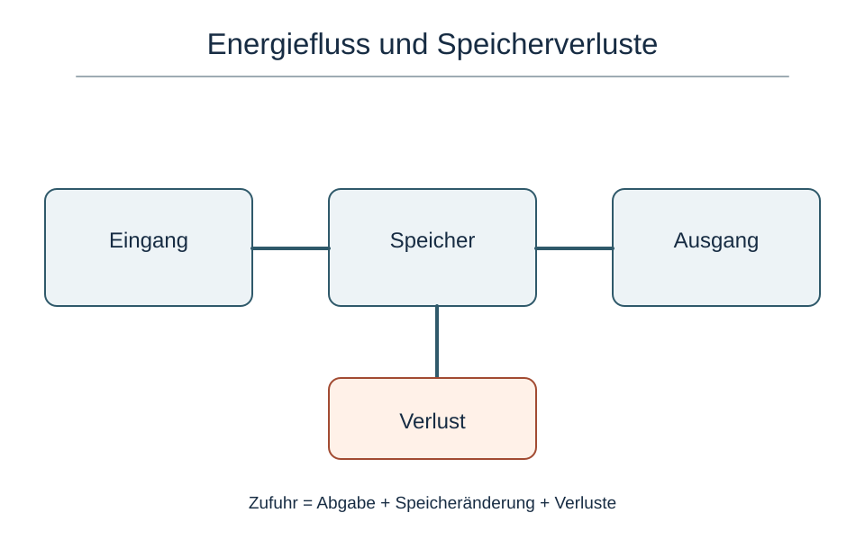

# M1-L1 – Energie, Leistung und Wirkungsgrad {#L1}

**Kursbereich:** M1 – Systemgrößen und Leistungsbilanzen  
**Niveau:** Bachelor · Grundlagen  
**Vorwissen:** Grundlagen der elektrischen Größen und elementare Mathematik.  
**Lernziel:** eine Speicherbilanz aufstellen, Leistung in Energie umrechnen und einen Zykluswirkungsgrad bestimmen.

## Einstieg {#S1}

Ein Pumpspeicherwerk nimmt im Pumpbetrieb elektrische Leistung auf und gibt im Turbinenbetrieb elektrische Leistung ab. Ein Stromnetz muss beides mit den übrigen Erzeugern und Lasten ausgleichen. Dafür sind drei Größen streng zu unterscheiden: **Leistung** beschreibt die momentane Umsetzungsrate, **Energie** die über einen Zeitraum umgesetzte Menge und **Wirkungsgrad** das Verhältnis von nutzbarer zu zugeführter Energie.

## Begriffe, Modell und Herleitung {#S2}

Eine Systemgrenze trennt die betrachtete Anlage von ihrer Umgebung. Definiere die über die Grenze in das System fließenden Leistungen als positiv. Für ein stationäres System ohne Speicheränderung gilt die Leistungsbilanz $P_\mathrm{zu}=P_\mathrm{ab}+P_\mathrm{Verlust}$. Für einen Speicher ist zusätzlich die zeitliche Änderung seines Energieinhalts zu berücksichtigen: $\mathrm dE_\mathrm{Speicher}/\mathrm dt=P_\mathrm{zu}-P_\mathrm{ab}-P_\mathrm{Verlust}$.

Die elektrische Wirkleistung einer einfachen Gleichstromstrecke oder eines passenden Einphasenmodells ist $P=UI$; bei Wechselstrom sind Effektivwerte und der Leistungsfaktor nötig. Energie ist $E=\int_{t_0}^{t_1}P(t)\,\mathrm dt$, bei konstanter Leistung $E=P\Delta t$. Aus $1\,\mathrm{kW}\cdot1\,\mathrm h=1\,\mathrm{kWh}$ folgt $1\,\mathrm{kWh}=3{,}6\,\mathrm{MJ}$. Ein Wirkungsgrad $\eta=E_\mathrm{nutz}/E_\mathrm{zu}$ gilt für eine klar definierte Zeitspanne und Systemgrenze; bei konstanten Leistungen kann dieselbe Relation mit Leistungen formuliert werden.

## Durchgerechnetes Beispiel {#S3}

Ein Speicher lädt zwei Stunden mit einer konstanten elektrischen Eingangsleistung von $5\,\mathrm{kW}$. Beim anschließenden Entladen liefert er $8\,\mathrm{kWh}$ an das Netz zurück. Aufgenommen wurden $E_\mathrm{in}=5\,\mathrm{kW}\cdot2\,\mathrm h=10\,\mathrm{kWh}$. Für den vollständigen Lade-/Entladezyklus folgt $\eta_\mathrm{rt}=8/10=0{,}80=80\,\%$. Die Differenz von $2\,\mathrm{kWh}$ ist in dieser Bilanz die nicht zurückgewonnene Energie. Das Ergebnis ist ein **angenommener Rechenfall**, keine Aussage über einen konkreten Speichertyp.

## Selbstkontrolle {#S4}

### Aufgaben

1. Ein Verbraucher bezieht 1,5 kW während 40 Minuten. Wie viel Energie ist das in kWh und MJ? Warum genügt der Wert nicht, um seine maximale Netzbelastung zu beurteilen?
2. Ein hypothetischer Prozess nimmt 12 kWh auf und gibt 9 kWh nutzbar ab. Berechne Wirkungsgrad und Verlustenergie.

::: {.lc-solutions data-lc-section="S4"}
1. $40\,\mathrm{min}=2/3\,\mathrm h$; somit $E=1{,}5\cdot2/3=1{,}0\,\mathrm{kWh}=3{,}6\,\mathrm{MJ}$. Über die höchste Momentanleistung oder den Einschaltstrom sagt die Energiemenge allein nichts aus.
2. 75 %; 3 kWh innerhalb der gewählten Bilanzgrenze.
:::

## Annahmen, Sicherheit und Grenzen {#S5}

Die Bilanz vernachlässigt bei einzelnen Beispielen Temperatur-, Alterungs- und zeitabhängige Nebenverluste. Eine positive Verlustleistung ist nicht „verschwundene“ Energie, sondern an die Umgebung abgegebene Energie. Wechselstromleistung wird gesondert eingeführt.

## Zusammenfassung und Übergang {#S6}

Leistung beschreibt einen zeitlichen Energiefluss, Energie dessen Integral. Systemgrenzen und einheitliche Zeithorizonte sind entscheidend; als Nächstes werden veränderliche Lasten untersucht.

**Weiterlesen:** [M1-L2 – Zeitreihen, Lastprofile und Gleichzeitigkeit](M1-L2.md).

## Quellen (extern) {#S7}

- [KIT, Elektrotechnisches Institut – Vertiefungsrichtung Elektrische Energietechnik](https://www.eti.kit.edu/730.php) · Beschreibung und Studienplan Bachelor/Master; Erzeugung, Übertragung, Speicherung, Antriebe, Regelung · Zuletzt abgerufen: 2026-11-23
- [Universität Stuttgart, Fakultät 5 – Electrical Power Systems](https://www.f05.uni-stuttgart.de/ei/studiengaenge/eeng/uebersicht/Electrical-Power-Systems/) · Studiengangsschwerpunkt Electrical Power Systems; Erzeugung, Verteilung, nachhaltige und zuverlässige Netze · Zuletzt abgerufen: 2026-11-23
