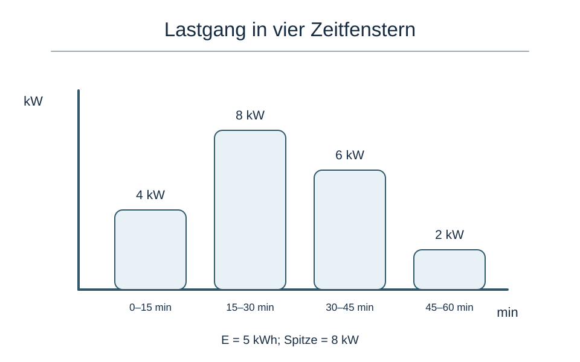

# M1-L2 – Zeitreihen, Lastprofile und Gleichzeitigkeit {#L2}

**Kursbereich:** M1 – Systemgrößen und Leistungsbilanzen  
**Niveau:** Bachelor · Grundlagen  
**Vorwissen:** Grundlagen der elektrischen Größen und elementare Mathematik.  
**Lernziel:** ein Lastprofil integrieren, mittlere und maximale Leistung unterscheiden und Gleichzeitigkeit beurteilen.

## Einstieg {#S1}

Ein Stromnetz wird nicht nach der Energie eines ganzen Tages dimensioniert: Leitungen und Betriebsmittel müssen auch den höchsten zeitgleichen Leistungsbedarf tragen. Ein **Lastgang** ist eine zeitgeordnete Folge von Leistungswerten; sein Integral ergibt die Energie. Das Zeitraster ist ein Teil der Messdefinition.

## Begriffe, Modell und Herleitung {#S2}

Für diskrete Messwerte mit konstantem Zeitabstand $\Delta t$ lautet die Energie-Näherung $E\approx\sum_{k=1}^{n}P_k\Delta t$. Die mittlere Last ist $\overline P=E/T$, die Spitzenlast $P_\mathrm{max}=\max_k P_k$. Der Lastfaktor $LF=\overline P/P_\mathrm{max}$ liegt bei nichtnegativen Lasten zwischen null und eins. Er ist kein elektrischer Leistungsfaktor $\cos\varphi$.

**Gleichzeitigkeit** bedeutet, dass Einzelspitzen nicht notwendig gleichzeitig auftreten. Die Spitze der Summe ist höchstens die Summe der Einzelspitzen; bei nichtnegativen Lasten kann sie deutlich darunter liegen. Ein Lastgang aus stündlichen Mittelwerten bildet Sekundenereignisse nicht zuverlässig ab. Bei Nettoeinspeisung muss zusätzlich die Vorzeichenkonvention angegeben werden.

## Durchgerechnetes Beispiel {#S3}

Vier Viertelstunden haben gemittelte Leistungen von $4$, $8$, $6$ und $2\,\mathrm{kW}$. Die Energie ist $(4+8+6+2)\cdot0{,}25=5\,\mathrm{kWh}$, der Mittelwert über die Stunde $5\,\mathrm{kW}$, die Viertelstunden-Spitze $8\,\mathrm{kW}$ und der Lastfaktor $5/8=0{,}625$. Für einen Anschluss, der längere Mittelwerte voraussetzt, ersetzt dieser Wert nicht eine thermische Detailauslegung.

## Selbstkontrolle {#S4}

### Aufgaben

1. Haushalt A benötigt in Stunde 1 3 kW und in Stunde 2 1 kW; Haushalt B benötigt 1 kW und danach 3 kW. Bestimme die Summenspitze und vergleiche sie mit der Summe der Einzelspitzen.
2. Drei Intervalle von 15, 30 und 15 min haben 2, 6 und 4 kW. Bestimme Energie, Mittelwert und gemittelte Intervallspitze.

::: {.lc-solutions data-lc-section="S4"}
1. Die summierte Last beträgt in beiden Stunden 4 kW. Die Summenspitze ist also 4 kW, während sich die Einzelspitzen zu 6 kW addieren. Das vereinfachte Beispiel illustriert Nichtgleichzeitigkeit.
2. 0,5+3+1=4,5 kWh; 4,5 kW; 6 kW.
:::

## Annahmen, Sicherheit und Grenzen {#S5}

Keine reale Bedarfsprognose entsteht ohne repräsentative Messwerte, Feiertage, Jahreszeit und Unsicherheitsband. Das Raster beeinflusst die gemessene Spitze; Netzanschlusswerte dürfen daraus nicht ungeprüft abgeleitet werden.

## Zusammenfassung und Übergang {#S6}

Ein Lastprofil verknüpft Leistung und Energie mit einer gewählten Zeitauflösung. Peaks hängen vom Messintervall ab; anschließend werden die AC-Leistungsgrößen eingeführt.

**Weiterlesen:** [M1-L3 – Drehstromleistung und Leistungsfaktor](M1-L3.md).

## Quellen (extern) {#S7}

- [KIT, Institut für Elektroenergiesysteme und Hochspannungstechnik – Elektrische Energienetze](https://www.ieh.kit.edu/2448_bee.php) · Inhaltsverzeichnis EEN (WS), Abschnitte 1–5; Drehstrom, Leistungsfluss, Netze, Fehler · Zuletzt abgerufen: 2026-11-23
- [Universität Stuttgart, Fakultät 5 – Electrical Power Systems](https://www.f05.uni-stuttgart.de/ei/studiengaenge/eeng/uebersicht/Electrical-Power-Systems/) · Studiengangsschwerpunkt Electrical Power Systems; Erzeugung, Verteilung, nachhaltige und zuverlässige Netze · Zuletzt abgerufen: 2026-11-23
