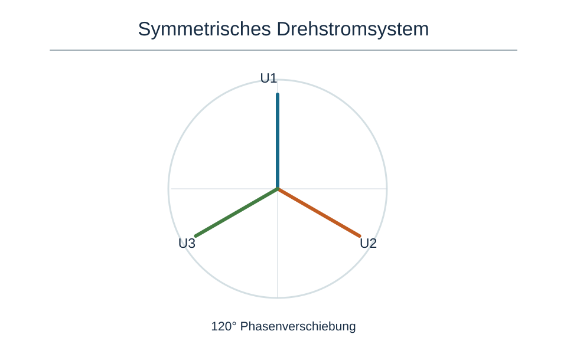

# M1-L3 – Drehstromleistung und Leistungsfaktor {#L3}

**Kursbereich:** M1 – Systemgrößen und Leistungsbilanzen  
**Niveau:** Bachelor · Grundlagen  
**Vorwissen:** Grundlagen der elektrischen Größen und elementare Mathematik.  
**Lernziel:** die Gesamtleistungen eines symmetrischen sinusförmigen Dreiphasensystems berechnen und Blindleistung einordnen.

## Einstieg {#S1}

Übertragungs- und Verteilnetze verwenden häufig Dreiphasensysteme. Die drei Strangspannungen sind im symmetrischen Fall zeitlich um 120° gegeneinander verschoben. Entscheidend ist, ob eine angegebene Spannung zwischen zwei Außenleitern oder zwischen Außenleiter und Sternpunkt gemessen wird.

## Begriffe, Modell und Herleitung {#S2}

Für ein symmetrisches sinusförmiges Dreiphasensystem gilt bei Sternschaltung $U_\mathrm{LL}=\sqrt3\,U_\mathrm{ph}$, wobei beide Spannungen Effektivwerte sind. Der Leitungsstrom entspricht dann dem Strangstrom. Bei einer symmetrischen Last ist die gesamte Scheinleistung $S=\sqrt3\,U_\mathrm{LL}I_\mathrm L$. Wirkleistung und Blindleistung lauten $P=\sqrt3\,U_\mathrm{LL}I_\mathrm L\cos\varphi$ und $Q=\sqrt3\,U_\mathrm{LL}I_\mathrm L\sin\varphi$; $S^2=P^2+Q^2$ bei sinusförmigen, symmetrischen Zuständen.

Wirkleistung $P$ in Watt beschreibt im Mittel nutzbare Energieübertragung; Blindleistung $Q$ in var entspricht periodischem Energieaustausch mit magnetischen oder elektrischen Feldern. Der Leistungsfaktor $\cos\varphi$ ist im ideal sinusförmigen Fall der Winkelkosinus zwischen Strangspannung und Strom. Bei Oberschwingungen ersetzt er nicht ohne Weiteres den allgemeinen Leistungsfaktor $P/S$.

## Durchgerechnetes Beispiel {#S3}

Ein **rein hypothetischer** symmetrischer Verbraucher hat $U_\mathrm{LL}=400\,\mathrm V$, $I_\mathrm L=10\,\mathrm A$ und $\cos\varphi=0{,}9$ (induktiv). Dann ist $S=\sqrt3\cdot400\cdot10\approx6{,}93\,\mathrm{kVA}$ und $P\approx6{,}24\,\mathrm{kW}$. Mit $\sin\varphi=\sqrt{1-0{,}9^2}\approx0{,}436$ folgt $Q\approx3{,}02\,\mathrm{kvar}$. Das sind Rechenwerte, keine Anschluss- oder Schutzvorgaben.

## Selbstkontrolle {#S4}

### Aufgaben

1. Welche Wirkleistung überträgt eine symmetrische sinusförmige Last mit 400 V Außenleiterspannung, 5 A Leitungsstrom und cos φ = 1? Warum darf man die Formel nicht unbesehen auf unsymmetrische Lasten anwenden?
2. Eine symmetrische sinusförmige Last benötigt 8 kW bei einem induktiven Leistungsfaktor 0,8. Bestimme S und Q.

::: {.lc-solutions data-lc-section="S4"}
1. $P=\sqrt3\cdot400\cdot5\cdot1\approx3{,}46\,\mathrm{kW}$. Bei Unsymmetrie müssen die Strangleistungen getrennt bilanziert werden; die vereinfachte Dreiphasenformel setzt gleiche Strangwerte voraus.
2. S=10 kVA; Q=6 kvar, unter Verbraucherkonvention positiv.
:::

## Annahmen, Sicherheit und Grenzen {#S5}

Drehstrom an elektrischen Anlagen ist lebensgefährlich. Keine praktischen Messungen, Verdrahtungen oder Anschlussversuche; alle Rechnungen sind reine Papier-/Simulationsbeispiele.

## Zusammenfassung und Übergang {#S6}

Die verkettete Spannung, der Leiterstrom und der Phasenwinkel bestimmen im symmetrischen Modell P, Q und |S|. Das bildet die Grundlage für Netzbetriebsmittel und Leitungsmodelle.

**Weiterlesen:** [M2-L1 – Netzebenen, Topologien und Versorgungspfade](M2-L1.md).

## Quellen (extern) {#S7}

- [KIT, Institut für Elektroenergiesysteme und Hochspannungstechnik – Elektrische Energienetze](https://www.ieh.kit.edu/2448_bee.php) · Inhaltsverzeichnis EEN (WS), Abschnitte 1–5; Drehstrom, Leistungsfluss, Netze, Fehler · Zuletzt abgerufen: 2026-11-23
- [KIT, Elektrotechnisches Institut – Vertiefungsrichtung Elektrische Energietechnik](https://www.eti.kit.edu/730.php) · Beschreibung und Studienplan Bachelor/Master; Erzeugung, Übertragung, Speicherung, Antriebe, Regelung · Zuletzt abgerufen: 2026-11-23
