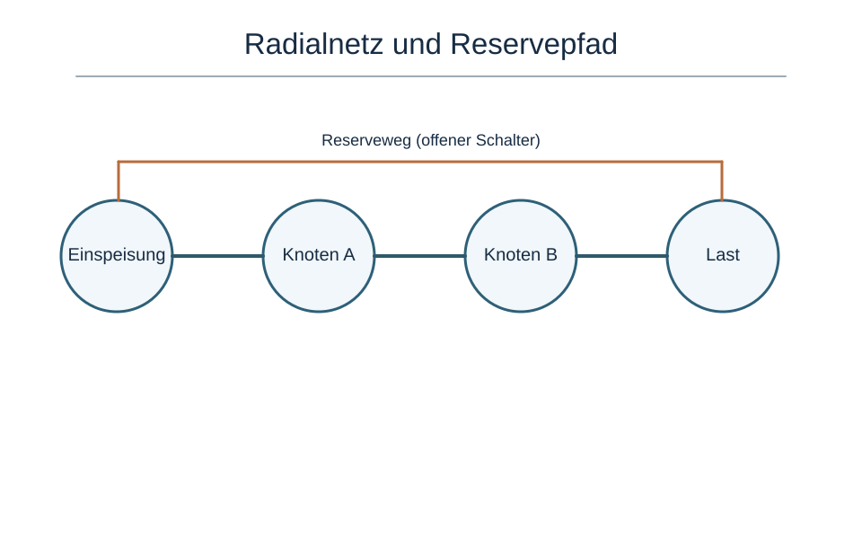

# M2-L1 – Netzebenen, Topologien und Versorgungspfade {#L1}

**Kursbereich:** M2 – Netzstrukturen und Betriebsmittel  
**Niveau:** Bachelor · Grundlagen  
**Vorwissen:** Grundlagen der elektrischen Größen und elementare Mathematik.  
**Lernziel:** Radial-, Ring- und Maschennetze als Graphen unterscheiden und mögliche Ausfallpfade erkennen.

## Einstieg {#S1}

Ein Netzplan ist mehr als eine Landkarte: Er beschreibt, welche Betriebsmittel elektrisch verbunden sind und welche Alternativwege bei einer Störung bestehen. Ein **radiales Netz** besitzt von der Einspeisung zum betrachteten Verbraucher zunächst nur einen eindeutigen Weg. Ring- und vermaschte Netze können alternative Pfade bieten, benötigen aber angepasste Schutz- und Betriebsstrategien.

## Begriffe, Modell und Herleitung {#S2}

Im Graphmodell ist eine Sammelschiene oder ein Netzknoten ein Vertex, eine Leitung oder ein Transformator eine Kante. Topologie allein legt noch keine Ströme fest; dafür werden Impedanzen, Einspeisungen und Spannungen benötigt. Eine Unterbrechung einer Kante in einem Radialnetz kann einen nachgeordneten Netzteil abtrennen, während ein vermaschtes Netz den Leistungsfluss umverteilen kann.

Spannungsebenen unterscheiden sich in Betriebsmitteln, Netzdimensionen und Aufgaben. In einer schematischen Versorgungskette werden Energieerzeugung, Übertragungsnetz, Umspannung, Verteilnetz und Endverbraucher verbunden. **Die exakten zulässigen Spannungen und Anschlusspflichten** hängen von Region, Netzbetreiber, Netzebene und jeweils gültigen Regeln ab und werden hier nicht pauschal festgelegt.

## Durchgerechnetes Beispiel {#S3}

In einem Radialnetz verläuft der Pfad A–B–C; B hat 2 MW Last, C 1 MW. Ohne Verlust und bei alleiniger Einspeisung in A trägt A–B 3 MW und B–C 1 MW. Öffnet A–B, verlieren B und C ohne Ersatzpfad ihre Versorgung. Fügt man eine schaltbare Kante A–C hinzu, entsteht eine mögliche Reserveverbindung; deren Belastbarkeit ist aber separat zu prüfen.

## Selbstkontrolle {#S4}

### Aufgaben

1. Ein Netz besteht aus den Kanten A–B, B–C, C–D. Was ändert die Kante A–D an der Verfügbarkeit von D bei Ausfall B–C? Warum reicht die Netzzeichnung nicht für einen Freigabebeschluss?
2. Ein verlustfreier radialer Pfad A–B–C–D hat Lasten 1, 2 und 3 MW an B, C, D. Bestimme die Zweigflüsse.

::: {.lc-solutions data-lc-section="S4"}
1. Es existiert ein weiterer Pfad A–D; D könnte bei passender Schaltung weiter versorgt werden. Ob die Leitungen dabei thermisch, spannungsseitig und schutztechnisch zulässig betrieben werden dürfen, folgt nicht aus der Topologie.
2. 6, 5 und 3 MW in Richtung D. Keine Aussage über zulässige Belastbarkeit.
:::

## Annahmen, Sicherheit und Grenzen {#S5}

Die Grafik zeigt logische Schaltungen und keine tatsächliche Netzkarte oder Schaltanweisung. Arbeiten an Verteilungen und Umspannwerken gehören ausschließlich zu qualifiziertem Fachpersonal.

Regelbezug **Deutschland, Niederspannung, Webstand 23.11.2026**: VDE FNN unterscheidet die TAR für Kundenanlagen (VDE-AR-N 4100:2026-04) von denen für Erzeugungsanlagen (VDE-AR-N 4105:2026-03). Zusätzlich veröffentlicht der jeweilige Netzbetreiber ergänzende TAB. Diese Webseiten belegen Zuständigkeit und Anwendungsbereich, nicht die Einhaltung technischer Einzelanforderungen durch das dargestellte Modell.

## Zusammenfassung und Übergang {#S6}

Topologie bestimmt mögliche Versorgungspfade, nicht deren elektrische Belastbarkeit. Der nächste Schritt ergänzt Leitungen und Transformatoren um physikalische Modelle.

**Weiterlesen:** [M2-L2 – Leitungsmodelle, Verluste und Transformatoren](M2-L2.md).

## Quellen (extern) {#S7}

- [KIT, Institut für Elektroenergiesysteme und Hochspannungstechnik – Elektrische Energienetze](https://www.ieh.kit.edu/2448_bee.php) · Inhaltsverzeichnis EEN (WS), Abschnitte 1–5; Drehstrom, Leistungsfluss, Netze, Fehler · Zuletzt abgerufen: 2026-11-23
- [KIT, Elektrotechnisches Institut – Vertiefungsrichtung Elektrische Energietechnik](https://www.eti.kit.edu/730.php) · Beschreibung und Studienplan Bachelor/Master; Erzeugung, Übertragung, Speicherung, Antriebe, Regelung · Zuletzt abgerufen: 2026-11-23
- [VDE FNN – TAR Niederspannung, VDE-AR-N 4100:2026-04](https://www.vde.com/de/fnn/themen/tar/tar-niederspannung/tar-niederspannung-vde-ar-n-4100) · Kundenanlagen am Niederspannungsnetz; öffentliche Regelübersicht, nicht Vollnorm · Webansicht geprüft: 2026-11-23
- [VDE FNN – TAR Erzeugungsanlagen Niederspannung, VDE-AR-N 4105:2026-03](https://www.vde.com/de/fnn/themen/tar/tar-niederspannung/erzeugungsanlagen-am-niederspannungsnetz-vde-ar-n-4105-2018) · Erzeugungsanlagen, Schutz, Betrieb und Nachweise; öffentliche Regelübersicht, nicht Vollnorm · Webansicht geprüft: 2026-11-23
