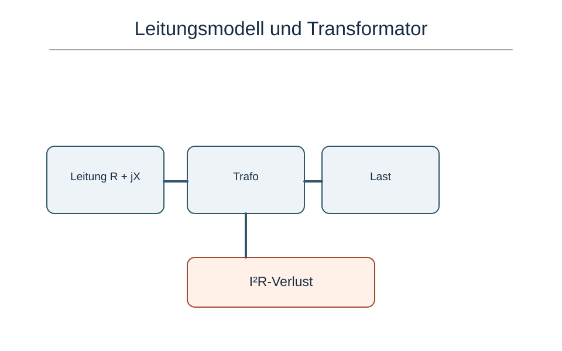

# M2-L2 – Leitungsmodelle, Verluste und Transformatoren {#L2}

**Kursbereich:** M2 – Netzstrukturen und Betriebsmittel  
**Niveau:** Bachelor · Grundlagen  
**Vorwissen:** Grundlagen der elektrischen Größen und elementare Mathematik.  
**Lernziel:** Dreiphasen-Kupferverluste und ideale Transformatorübersetzungen mit klaren Annahmen berechnen.

## Einstieg {#S1}

Übertragungs- und Verteilungsverluste hängen von Strom, Leiterwiderstand und Betriebszustand ab. Für Netzrechnungen werden Leitungen durch Ersatzschaltbilder beschrieben, die Widerstand, induktive Reaktanz und – bei längeren Strecken – kapazitive Effekte enthalten. Transformatoren passen Spannungsniveaus an, ohne elektrische Energie zu erzeugen.

## Begriffe, Modell und Herleitung {#S2}

Für einen vereinfachten symmetrischen Leiter mit ohmschem Widerstand $R$ ist die Wirkleistungsverlustleistung $P_\mathrm V=I^2R$ je Leiter. Bei drei identischen Phasen folgt $P_{\mathrm V,3}=3I^2R$. Eine Leitung kann im Grundfrequenz-Zeigermodell die Serienimpedanz $Z=R+\mathrm jX$ besitzen. Ihre Stromabhängigkeit und die Phasenlage führen zu komplexen Spannungsfällen.

Beim idealen Transformator gilt $U_1/U_2=N_1/N_2=a$ und näherungsweise $I_1/I_2=1/a$ für die Beträge bei Leistungsübertragung; reale Transformatoren haben Kupfer-, Eisen- und Streuverluste. Der ideale Ansatz ist eine erste Modellstufe, kein Typenschildersatz.

## Durchgerechnetes Beispiel {#S3}

Eine **fiktive** symmetrische dreiphasige Leitung hat pro Phase $R=0{,}40\,\Omega$ und führt $I=100\,\mathrm A$. Ihre ohmsche Verlustleistung beträgt $3\cdot100^2\cdot0{,}40=12\,000\,\mathrm W=12\,\mathrm{kW}$. Verdoppelt sich der Strom bei unverändertem Widerstand, wächst die Verlustleistung auf $48\,\mathrm{kW}$, also auf das Vierfache. Daraus folgt nicht, dass man Spannung beliebig erhöhen darf; Isolation, Netztopologie und Betriebsmittel setzen Grenzen.

## Selbstkontrolle {#S4}

### Aufgaben

1. Ein idealer einphasiger Transformator besitzt eine Spannungsübersetzung von 10 kV zu 1 kV. Bei 20 A Primärstrom: Bestimme Sekundärstrom und Scheinleistungsbetrag. Wie groß wäre stattdessen die gesamte Scheinleistung eines symmetrischen dreiphasigen Systems bei denselben Leiter-Leiter-Spannungen und Leiterströmen, wenn die idealen Leiter-Spannungs-/Stromverhältnisse entsprechend vorgegeben sind?
2. Eine symmetrische Dreiphasenleitung hat 0,2 Ohm je Phase. Vergleiche die ohmschen Verluste bei 50 und 150 A.

::: {.lc-solutions data-lc-section="S4"}
1. $I_2=10\cdot20=200\,\mathrm A$. Einphasig: $|S|=10\,\mathrm{kV}\cdot20\,\mathrm A=200\,\mathrm{kVA}$. Bei symmetrischem Drehstrom und Leitergrößen: $|S|=\sqrt3\cdot10\,\mathrm{kV}\cdot20\,\mathrm A\approx346{,}41\,\mathrm{kVA}$. Es handelt sich um Scheinleistung, nicht um eine garantierte Wirkleistung oder Nennleistung.
2. 3×0,2×50²=1500 W; 13 500 W; Faktor 9.
:::

## Annahmen, Sicherheit und Grenzen {#S5}

Das Beispiel ignoriert Leitungskapazität, frequenzabhängige Verluste, Kurzschlussverhalten und Temperatur. Selbst 1 kV ist hochgefährlich. Keine Praxisversuche, Geräteeinstellungen oder Schutzdimensionierung nach diesem Modell.

## Zusammenfassung und Übergang {#S6}

Leitungswiderstand erzeugt I²R-Verluste; Transformatoren koppeln Spannung und Strom über ihr Übersetzungsverhältnis. Für die Spannungshaltung muss auch Blindleistung berücksichtigt werden.

**Weiterlesen:** [M2-L3 – Spannungshaltung und Blindleistungsflüsse](M2-L3.md).

## Quellen (extern) {#S7}

- [KIT, Institut für Elektroenergiesysteme und Hochspannungstechnik – Elektrische Energienetze](https://www.ieh.kit.edu/2448_bee.php) · Inhaltsverzeichnis EEN (WS), Abschnitte 1–5; Drehstrom, Leistungsfluss, Netze, Fehler · Zuletzt abgerufen: 2026-11-23
- [TU Dresden, Fakultät Elektrotechnik und Informationstechnik – Wahlpflichtmodule ET, MT, IST, RES](https://tu-dresden.de/ing/elektrotechnik/studium/im_studium/lehrangebot/wahlpflichtmodule) · Planning of Electrical Power Systems / Fundamentals of Electrical Power Systems / Controlled Power Systems; Netzplanung, Netzberechnung, Betriebsmittel, Regelung · Zuletzt abgerufen: 2026-11-23
