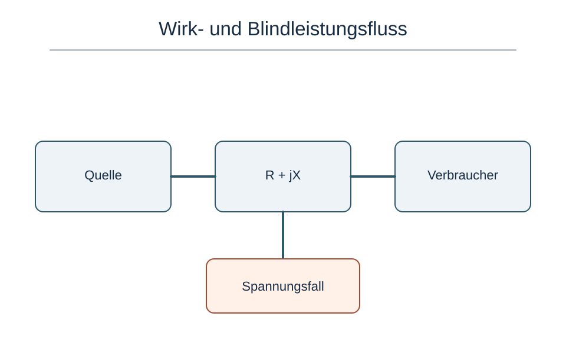

# M2-L3 – Spannungshaltung und Blindleistungsflüsse {#L3}

**Kursbereich:** M2 – Netzstrukturen und Betriebsmittel  
**Niveau:** Bachelor · Grundlagen  
**Vorwissen:** Grundlagen der elektrischen Größen und elementare Mathematik.  
**Lernziel:** vereinfachte Spannungsfälle deuten und die Wirkung induktiver oder kapazitiver Blindleistung erklären.

## Einstieg {#S1}

Die Spannung an einem Verbraucher hängt nicht nur von der Nennspannung des Netzes ab. Strom, Impedanz, Lastzustand und lokale Einspeisung verändern das Spannungsprofil. Blindleistung ist deshalb in Wechselstromnetzen nicht bloß eine zusätzliche Zahl: Sie steht in Beziehung zur Spannungsführung und zu Betriebsmittelbelastungen.

## Begriffe, Modell und Herleitung {#S2}

Für eine kurze Leitung mit Serienimpedanz $R+\mathrm jX$ und einem vereinfachten Verbraucher kann im geeigneten Betriebsbereich der Spannungsfall näherungsweise als $\Delta U\approx(RP+XQ)/U$ beschrieben werden, wenn $U$ die verwendete Bezugsspannung derselben Modellkonvention ist. Das ist eine **linearisierte** Beziehung, kein universelles Netzgesetz. Der genaue AC-Zustand erfordert komplexe Knotenspannungen und eine Leistungsflussrechnung.

Induktive Lasten nehmen typischerweise positive Blindleistung nach Verbraucherzählpfeilsystem auf; kapazitive Elemente können unter derselben Konvention negative Blindleistung aufnehmen beziehungsweise Blindleistung einspeisen. Technische Maßnahmen sind beispielsweise regelbare Transformatoren, geeignete Blindleistungsbereitstellung und Anpassungen des Betriebs. Welche Anlage welche Vorgaben einhalten muss, ist standort- und zeitabhängig.

## Durchgerechnetes Beispiel {#S3}

Für ein bewusst einfaches **einphasiges Ersatzmodell** seien $R=0{,}10\,\Omega$, $X=0{,}20\,\Omega$, $P=10\,\mathrm{kW}$, $Q=5\,\mathrm{kvar}$ und $U=400\,\mathrm V$ gewählt. Die lineare Näherung liefert $\Delta U\approx(0{,}10\cdot10\,000+0{,}20\cdot5\,000)/400=5\,\mathrm V$. Falls bei sonst gleichem Modell $Q$ auf null sinkt, wären es $2{,}5\,\mathrm V$. Für reale Drehstromnetze ist die konsistente Phasen-/Leiterspannungsbasis nötig.

## Selbstkontrolle {#S4}

### Aufgaben

1. In der linearen Näherung mit konstantem R, X, P und U: Welche Richtung hat die Änderung von ΔU, wenn Q verringert wird und X positiv ist?
2. Im einphasigen linearen Modell gelten R=0,1 Ohm, X=0,2 Ohm, P=4 kW, Q=−1 kvar, U=200 V. Berechne den näherungsweisen Spannungsfall.

::: {.lc-solutions data-lc-section="S4"}
1. $\partial(\Delta U)/\partial Q=X/U>0$. Ein kleineres $Q$ vermindert die Näherung des Spannungsfalls. Ob die Spannung an einem realen Einspeisepunkt tatsächlich steigt, erfordert eine vollständige Netzrechnung.
2. (400−200)/200=1 V. Negatives Q reduziert in diesem Modell den Fall.
:::

## Annahmen, Sicherheit und Grenzen {#S5}

Näherungsformeln können an Netzen mit hohem R/X, unsymmetrischen Lasten, großen Phasenverschiebungen oder Spannungsabhängigkeiten ungenau sein. Keine Einstellwerte für reale Anlagen ableiten.

## Zusammenfassung und Übergang {#S6}

Spannungshaltung hängt von Netzimpedanz, Wirkleistung und Blindleistung ab. Vereinfachte Modelle liefern Trends, jedoch keine betrieblich freigegebene Netzberechnung.

**Weiterlesen:** [M3-L1 – Thermische und elektromechanische Umwandlung](M3-L1.md).

## Quellen (extern) {#S7}

- [KIT, Institut für Elektroenergiesysteme und Hochspannungstechnik – Elektrische Energienetze](https://www.ieh.kit.edu/2448_bee.php) · Inhaltsverzeichnis EEN (WS), Abschnitte 1–5; Drehstrom, Leistungsfluss, Netze, Fehler · Zuletzt abgerufen: 2026-11-23
- [Bundesnetzagentur – Redispatch](https://www.bundesnetzagentur.de/DE/Fachthemen/ElektrizitaetundGas/Versorgungssicherheit/Netzengpassmanagement/Engpassmanagement/Redispatch/artikel.html) · Einleitung und Redispatch-Abschnitte; Netzengpass, Eingriff in Erzeugungsleistung, Blindleistung · Zuletzt abgerufen: 2026-11-23
