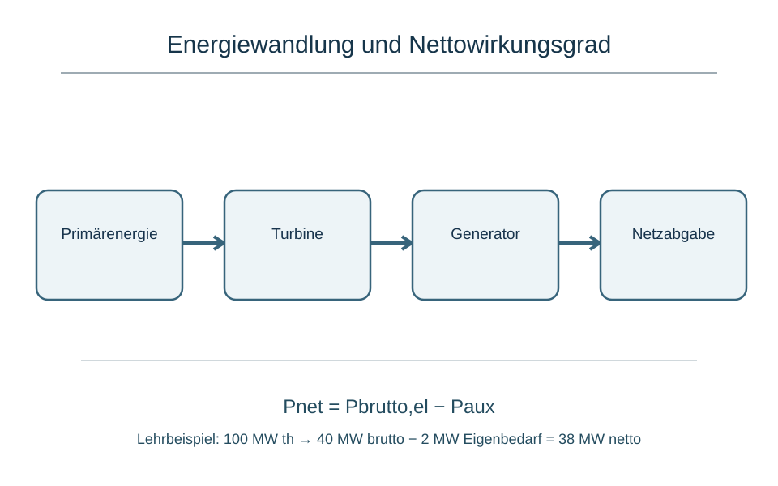

# M3-L1 – Thermische und elektromechanische Umwandlung {#L1}

**Kursbereich:** M3 – Erzeugung, Umwandlung und Flexibilität  
**Niveau:** Bachelor · Aufbau/Wahlprofil  
**Vorwissen:** Grundlagen der elektrischen Größen und elementare Mathematik.  
**Lernziel:** eine mehrstufige Energiewandlungskette mit Teilwirkungsgraden bilanzieren.

## Einstieg {#S1}

Elektrischer Strom wird häufig aus Wärme, Strömungsenergie oder mechanischer Wellenleistung gewonnen. Für die Beurteilung einer Anlage zählt nicht nur der Generatorwirkungsgrad, sondern die ganze Umwandlungskette vom eingesetzten Energieträger bis zum Netzanschlusspunkt. Ein Turbinengenerator ist eine **energiewandelnde** und keine energieerzeugende Maschine im physikalischen Sinn.

## Begriffe, Modell und Herleitung {#S2}

Die Leistungen einer seriellen Umwandlungskette folgen $P_{k+1}=\eta_k P_k$, wenn die Wirkungsgrade $\eta_k$ für dieselbe Betriebsbedingung gelten. Der Gesamtwirkungsgrad mehrerer Stufen ist $\eta_\mathrm{ges}=\prod_k\eta_k$. Bei thermischen Kraftwerken spielen Temperatur­niveaus, Wärmeabfuhr und der verwendete Prozess eine Rolle; die nutzbare Wärme kann bei Kraft-Wärme-Kopplung zusätzlich bilanziert werden. Elektrische Leistung am Generatorterminal ist nicht mit **Nettoeinspeisung** identisch: Eigenbedarf, Transformator- und Leitungsverluste reduzieren die abgegebene Leistung. Für das thermische Brutto-/Nettomodell gilt bei klar definierten Bilanzgrenzen $P_{\mathrm{brutto,el}}=\eta_{\mathrm{brutto,el}}P_{\mathrm{th,in}}$ und $P_{\mathrm{netto,el}}=P_{\mathrm{brutto,el}}-P_{\mathrm{aux}}$; $P_{\mathrm{aux}}$ umfasst die im Modell abgezogenen Eigenverbräuche und internen Verluste.

Für eine elektrische Maschine mit mechanischer Wellenleistung $P_\mathrm{mech}$ kann man vereinfachend $P_\mathrm{el}=\eta_\mathrm G P_\mathrm{mech}$ verwenden. Bei einem Windrad hängt die mechanisch nutzbare Leistung von Strömung und Rotor ab; bei einer Wasserkraftanlage von Durchfluss und nutzbarer Fallhöhe. Diese Gleichungen ersetzen keine spezifische Kennlinie.

## Durchgerechnetes Beispiel {#S3}

Ein **rein fiktives** Kraftwerk erhält $100\,\mathrm{MW}$ thermische Eingangsleistung und erreicht am Generator einen elektrischen Bruttowirkungsgrad von 40 %. Damit beträgt die Bruttoleistung $40\,\mathrm{MW}$. Entfallen $2\,\mathrm{MW}$ auf Eigenbedarf und internen Verbrauch, verbleiben $38\,\mathrm{MW}$ Nettoleistung. Bezogen auf den thermischen Eingang ergibt das $\eta_\mathrm{netto}=38/100=38\,\%$. Wer nur die Bruttoleistung bilanziert, überschätzt die Netzabgabe um $2\,\mathrm{MW}$.

## Selbstkontrolle {#S4}

### Aufgaben

1. Eine mechanische Welle liefert 12 MW. Generator- und Transformatorwirkungsgrad betragen 0,97 beziehungsweise 0,99. Wie viel Leistung wird im Modell abgegeben?
2. Ein fiktiver thermischer Eingang von 50 MW ergibt bei 42 % Bruttowirkungsgrad elektrische Leistung. 1 MW Eigenbedarf: Nettoleistung und Nettowirkungsgrad?

::: {.lc-solutions data-lc-section="S4"}
1. Die elektrische Ausgangsleistung hinter dem Transformator beträgt $12\cdot0{,}97\cdot0{,}99=11{,}5236\,\mathrm{MW}\approx11{,}52\,\mathrm{MW}$. Beide Wirkungsgrade gelten für denselben Betriebspunkt; weitere Hilfsverbräuche werden nicht berücksichtigt.
2. 21−1=20 MW; 40 %.
:::

## Annahmen, Sicherheit und Grenzen {#S5}

Netto- und Bruttoangaben sowie die Bezugsgröße von Wirkungsgraden sind vor jedem Vergleich zu prüfen. Wirkungsgrade variieren mit Last, Temperatur und Anlagenkonfiguration; Zeitreihen oder reale Kraftwerksdaten werden hier nicht behauptet.

## Zusammenfassung und Übergang {#S6}

Der Gesamtwirkungsgrad einer seriellen Wandlung ergibt sich aus den Teilwirkungsgraden bei gleicher Systemgrenze. Anschließend wird die zeitvariable erneuerbare Einspeisung betrachtet.

**Weiterlesen:** [M3-L2 – Photovoltaik, Wind und netzgekoppelte Umrichter](M3-L2.md).

## Quellen (extern) {#S7}

- [KIT, Elektrotechnisches Institut – Vertiefungsrichtung Elektrische Energietechnik](https://www.eti.kit.edu/730.php) · Beschreibung und Studienplan Bachelor/Master; Erzeugung, Übertragung, Speicherung, Antriebe, Regelung · Zuletzt abgerufen: 2026-11-23
- [Universität Stuttgart, Fakultät 5 – Electrical Power Systems](https://www.f05.uni-stuttgart.de/ei/studiengaenge/eeng/uebersicht/Electrical-Power-Systems/) · Studiengangsschwerpunkt Electrical Power Systems; Erzeugung, Verteilung, nachhaltige und zuverlässige Netze · Zuletzt abgerufen: 2026-11-23
