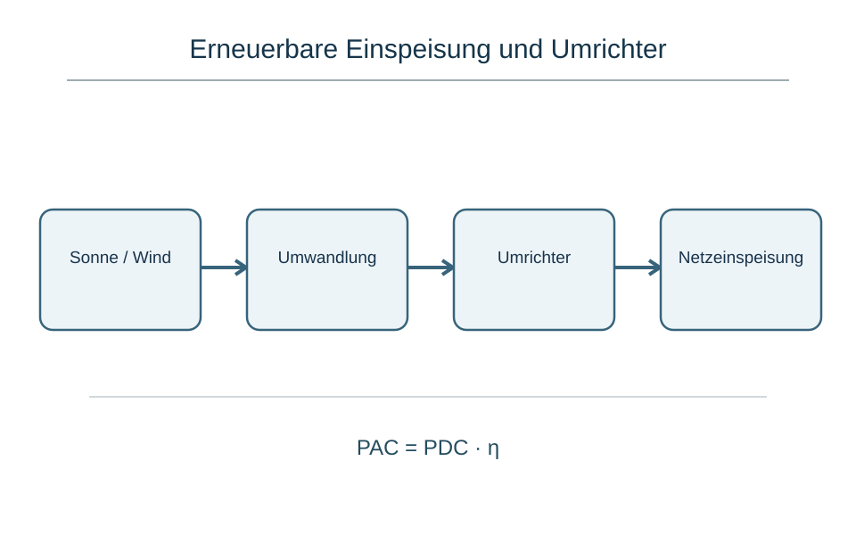

# M3-L2 – Photovoltaik, Wind und netzgekoppelte Umrichter {#L2}

**Kursbereich:** M3 – Erzeugung, Umwandlung und Flexibilität  
**Niveau:** Bachelor · Aufbau/Wahlprofil  
**Vorwissen:** Grundlagen der elektrischen Größen und elementare Mathematik.  
**Lernziel:** ein vereinfachtes PV- oder Wind-Einspeisemodell berechnen und die Rolle eines Umrichters erläutern.

## Einstieg {#S1}

Photovoltaikanlagen erzeugen zunächst Gleichstrom; das öffentliche Wechselstromnetz benötigt eine geeignete Kopplung durch Wechselrichter. Windenergieanlagen wandeln zunächst Bewegungsenergie in mechanische und elektrische Leistung. Die Einspeisung ist wetterabhängig und führt zu anderen Zeitprofilen als ein regelbares thermisches Kraftwerk.

## Begriffe, Modell und Herleitung {#S2}

Für eine überschlägige PV-Abschätzung kann die abgegebene Wechselstromleistung als $P_\mathrm{AC}\approx P_\mathrm{STC}(G/G_\mathrm{ref})f_\mathrm{temp}\eta_\mathrm{inv}$ modelliert werden, wobei $P_\mathrm{STC}$ die Referenzleistung, $G$ die Einstrahlung in Modulebene, $f_\mathrm{temp}$ einen Temperatur-/Betriebsfaktor und $\eta_\mathrm{inv}$ den Umrichterwirkungsgrad bezeichnet. Diese grobe Proportionalität gilt nur innerhalb des nicht abgeregelten Bereichs und ignoriert weitere Verluste.

Die im Wind ideal verfügbare Strömungsleistung ist $P_\mathrm{Wind}=\tfrac12\rho A v^3$. Der Rotor kann davon nur einen Anteil nutzen; bei realen Anlagen begrenzen Kennlinie, Regelung und Abschaltbedingungen die Einspeisung. Netzgekoppelte Umrichter können Wirkleistung und innerhalb ihrer technischen Grenzen Blindleistung bereitstellen; konkrete Netzanschlussanforderungen sind standort- und versionsabhängig.

## Durchgerechnetes Beispiel {#S3}

Eine **beispielhafte** PV-Anlage mit $8\,\mathrm{kW}$ Referenzleistung erhält eine Einstrahlung von 60 % des Referenzwertes. Der zusammengefasste Temperatur-/Umrichter-/Verlustfaktor sei $0{,}90$. Daraus folgt $P_\mathrm{AC}\approx8\cdot0{,}6\cdot0{,}9=4{,}32\,\mathrm{kW}$. Werden in einer fiktiven Betriebsentscheidung 10 % davon abgeregelt, sind es $3{,}888\,\mathrm{kW}$. Abregelung darf nicht mit einer gesunkenen Einstrahlung verwechselt werden.

### Vertiefung 1

**Lernziel:** Die vereinfachte P-Q-Grenze eines Umrichters interpretieren und zwischen Leistungsgrenze und verfügbarer Energie unterscheiden.

Bei sinusförmigen symmetrischen Dreiphasengrößen und angenommener konstanter Nennscheinleistung gilt $P^2+Q^2\le S_\mathrm{N}^2$. Die Grenze ist eine vereinfachte kreisförmige Kennlinie; reale Strom-, Temperatur-, Spannungs- und DC-seitige Grenzen können den zulässigen Bereich verkleinern. Positive Werte von P bezeichnen hier Einspeisung; die Blindleistungsrichtung muss über eine ausdrücklich festgelegte Konvention definiert werden. Es wird nur der Betrag von Q berechnet.

Ein Wechselrichter mit $S_\mathrm{N}=100\,\mathrm{kVA}$ speise $P=80\,\mathrm{kW}$ ein. Dann ist $|Q|_\mathrm{max}=\sqrt{100^2-80^2}=60\,\mathrm{kvar}$. Bei geforderten 75 kvar reduziert sich die maximal zulässige Wirkleistung auf $\sqrt{100^2-75^2}=66{,}14\,\mathrm{kW}$. Sind weiterhin 80 kW verfügbar, müssten im Lehrmodell mindestens 13,86 kW nicht eingespeist werden. Bei konstanter Lage über eine Viertelstunde entspricht das 3,46 kWh. Ob diese Energie gespeichert werden kann oder verloren geht, hängt von der DC-Seite ab.

Netzfolgende (grid-following) und netzbildende (grid-forming) Regelung sind von dieser stationären P-Q-Grenze zu unterscheiden. Netzfolgende Regelung orientiert sich typischerweise an einer vorhandenen Netzspannungsreferenz. Netzbildende Regelung erzeugt eine eigene Spannungsreferenz und kann zur Frequenz- und Spannungsführung beitragen. Die Bezeichnungen garantieren weder uneingeschränkten Inselbetrieb noch Schwarzstartfähigkeit oder eine bestimmte Fehlerstromabgabe. Zusätzliche Wirkleistung setzt eine geeignete Energiequelle und Leistungsreserve voraus.

## Selbstkontrolle {#S4}

### Aufgaben

1. Welche ideal verfügbare Windleistung ergibt sich relativ, wenn die Windgeschwindigkeit von 5 m/s auf 10 m/s steigt, während Luftdichte und Rotorfläche gleich bleiben? Warum kann man nicht denselben Faktor für die echte Turbineneinspeisung garantieren?
2. Eine vereinfachte PV-Anlage liefert vor Abregelung 6 kW über 30 min. Eine Begrenzung auf 4 kW gilt für das gesamte Intervall. Bestimme abgegebene und abgeregelte Energie.
3. Welche Blindleistungsreserve ergibt sich bei 96 kW und unverändert 100 kVA?
4. Ist eine gleichzeitige Abgabe von 80 kW und 75 kvar zulässig?
5. Wie viel zusätzliche Energie ist für 20 kW Wirkleistungsunterstützung über 10 s erforderlich (verlustfrei)?

::: {.lc-solutions data-lc-section="S4"}
1. Das ideale Strömungsleistungsverhältnis ist $(10/5)^3=8$. Eine reale Turbine hat Leistungskennlinien, Maximalleistung und Betriebsgrenzen, weshalb die Netzabgabe nicht zwangsläufig achtmal so groß ist.
2. 2 kWh abgegeben; 1 kWh abgeregelt.
3. 28 kvar.
4. $S=109{,}66\,\mathrm{kVA}$, also nein im angenommenen Modell.
5. 200 kJ bzw. 0,0556 kWh; Energie- und Leistungsgrenze sind getrennt zu prüfen.
:::

## Annahmen, Sicherheit und Grenzen {#S5}

Die Formeln sind Systemabschätzungen, keine Ertragsgutachten. Wechselrichter sind elektrisch gefährliche Geräte; keine Anschluss-, Parametrier- oder Messanleitung. Jahreserträge erfordern Wetterzeitreihen, Ausrichtung, Verschattung und Verluste.

**Geltungsbeispiel Deutschland, Niederspannung (Webprüfung 23.11.2026):** VDE FNN bezeichnet die VDE-AR-N 4105:2026-03 als Technische Anschlussregel für Erzeugungsanlagen am Niederspannungsnetz. Sie betrifft unter anderem Netz- und Anlagenschutz, Betrieb und Nachweise elektrischer Eigenschaften; ergänzend gelten die TAB des jeweiligen Netzbetreibers. Aus der öffentlich einsehbaren Regelübersicht werden hier bewusst keine Anschluss-, Prüf- oder Einstellwerte übernommen.

## Zusammenfassung und Übergang {#S6}

Erneuerbare Einspeisung variiert mit Umweltbedingungen und technischen Grenzen. Leistungselektronik stellt die Netzschnittstelle her; Speicher verschieben die zeitliche Bereitstellung.

**Weiterlesen:** [M3-L3 – Speicher, Ladezustand und Sektorkopplung](M3-L3.md).

## Quellen (extern) {#S7}

- [KIT, Elektrotechnisches Institut – Vertiefungsrichtung Elektrische Energietechnik](https://www.eti.kit.edu/730.php) · Beschreibung und Studienplan Bachelor/Master; Erzeugung, Übertragung, Speicherung, Antriebe, Regelung · Zuletzt abgerufen: 2026-11-23
- [Universität Stuttgart, Fakultät 5 – Electrical Power Systems](https://www.f05.uni-stuttgart.de/ei/studiengaenge/eeng/uebersicht/Electrical-Power-Systems/) · Studiengangsschwerpunkt Electrical Power Systems; Erzeugung, Verteilung, nachhaltige und zuverlässige Netze · Zuletzt abgerufen: 2026-11-23
- [Universität Stuttgart – Prüfungsordnung Nr. 36/2025](https://www.uni-stuttgart.de/universitaet/aktuelles/bekanntmachungen/Amtliche-Bekanntmachung-Nummer-36-2025/) · Anlage 2, § 5 Abs. 2 a), Stromnetz-/Erneuerbaren-Module im gewählten Bachelor-Wahlbereich · Webansicht geprüft: 2026-11-23
- [VDE FNN – TAR Erzeugungsanlagen Niederspannung, VDE-AR-N 4105:2026-03](https://www.vde.com/de/fnn/themen/tar/tar-niederspannung/erzeugungsanlagen-am-niederspannungsnetz-vde-ar-n-4105-2018) · Erzeugungsanlagen, Schutz, Betrieb und Nachweise; öffentliche Regelübersicht, nicht Vollnorm · Webansicht geprüft: 2026-11-23
- [U.S. Department of Energy – UNIFI Consortium](https://www.energy.gov/cmei/systems/unifi-consortium) · What are Grid Forming Inverters?; Netzbildungs- und Netzfolgeprinzip · Zuletzt abgerufen: 2026-11-24
