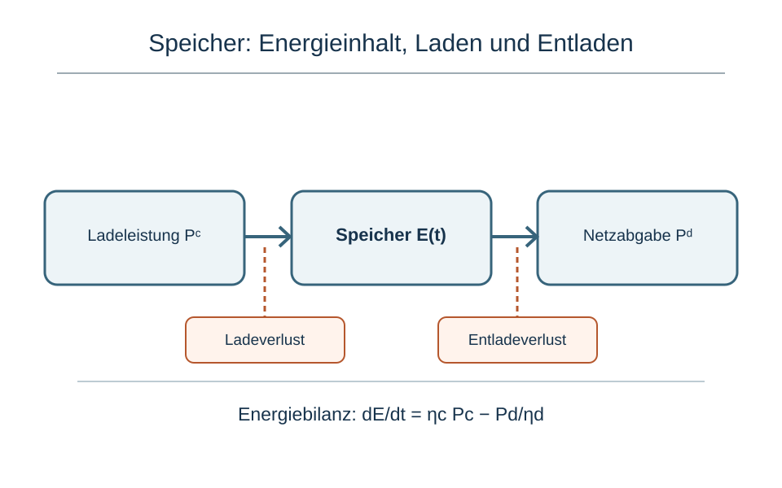

# M3-L3 – Speicher, Ladezustand und Sektorkopplung {#L3}

**Kursbereich:** M3 – Erzeugung, Umwandlung und Flexibilität  
**Niveau:** Bachelor · Aufbau/Wahlprofil  
**Vorwissen:** Grundlagen der elektrischen Größen und elementare Mathematik.  
**Lernziel:** den Speicherladezustand mit Lade-/Entladeleistungen und Wirkungsgraden fortschreiben.

## Einstieg {#S1}

Energiespeicher trennen den Zeitpunkt der Energieaufnahme vom Zeitpunkt der Energieabgabe. Netztechnisch sind zwei Grenzen wesentlich: die momentan mögliche **Leistung** in MW und die insgesamt verfügbare **Energie** in MWh. Eine große Energieangabe ist kein Beleg für eine beliebig hohe Entladeleistung.

## Begriffe, Modell und Herleitung {#S2}

Sei $E(t)$ der nutzbare Energieinhalt, $P_\mathrm c\ge0$ die elektrische Ladeleistung und $P_\mathrm d\ge0$ die elektrische Abgabeleistung. Mit Ladewirkungsgrad $\eta_\mathrm c$ und Entladewirkungsgrad $\eta_\mathrm d$ gilt im einfachsten Modell $\mathrm dE/\mathrm dt=\eta_\mathrm cP_\mathrm c-P_\mathrm d/\eta_\mathrm d$. Der Ladezustand ist $SOC=E/E_\mathrm{max}$; Lade- und Entladeleistung unterliegen zusätzlich Grenzen. Simultanes Laden und Entladen ist in dieser Lernaufgabe ausgeschlossen.

Sektorkopplung verbindet Strom mit Wärme, Mobilität oder gasförmigen Energieträgern. Ein Elektrolyseur ist etwa ein elektrischer Verbraucher mit chemischem Energieoutput; auch hier müssen Systemgrenze, Wirkungsgrad und zeitliche Verfügbarkeit benannt werden. Stromspeicher und Wasserstoffketten haben unterschiedliche Ziele und Verluste.

## Durchgerechnetes Beispiel {#S3}

Ein hypothetischer Speicher hat $E_\mathrm{max}=20\,\mathrm{MWh}$ und startet mit $E_0=8\,\mathrm{MWh}$. Zwei Stunden Ladung mit $4\,\mathrm{MW}$ bei $\eta_\mathrm c=0{,}90$ erhöhen den Inhalt um $7{,}2\,\mathrm{MWh}$ auf $15{,}2\,\mathrm{MWh}$. Eine Stunde Abgabe von $3\,\mathrm{MW}$ bei $\eta_\mathrm d=0{,}90$ entzieht dem Speicher $3/0{,}90\approx3{,}33\,\mathrm{MWh}$. Rest: etwa $11{,}87\,\mathrm{MWh}$ oder 59,3 % SOC.

## Selbstkontrolle {#S4}

### Aufgaben

1. Wie viele Stunden könnte derselbe Speicher bei 60 % SOC mit konstant 3 MW elektrischer Abgabeleistung liefern, wenn Entladewirkungsgrad 90 % und keine Mindest-SOC-Grenze berücksichtigt werden?
2. Ein Speicher enthält 5 MWh, Mindestinhalt 2 MWh, Entladewirkungsgrad 80 %, Abgabe 2 MW. Wie lange kann er im Modell liefern?

::: {.lc-solutions data-lc-section="S4"}
1. Gespeichert sind $0{,}60\cdot20=12\,\mathrm{MWh}$. Elektrisch nutzbar sind $12\cdot0{,}90=10{,}8\,\mathrm{MWh}$. Dauer: $10{,}8/3=3{,}6\,\mathrm h$. In der Praxis schränken SOC-Grenzen und Leistungskennlinien ein.
2. (5−2)×0,8/2=1,2 h; Leistungsgrenze muss 2 MW zulassen.
:::

## Annahmen, Sicherheit und Grenzen {#S5}

Das Modell berücksichtigt keine Selbstentladung, Temperatur, Alterung, Hilfsverbraucher oder Mindestreserve. Für Batteriesicherheit und Anlagenbetrieb sind gesonderte Fachvorschriften nötig; keine Ladegeräte oder Stromkreise praktisch nachbauen.

## Zusammenfassung und Übergang {#S6}

Für den Speicherzustand zählen Energieinhalt, Leistungsgrenzen und getrennte Verluste. Der zeitliche Einsatz beeinflusst Netzflüsse, die im nächsten Modul modelliert werden.

**Weiterlesen:** [M4-L1 – Knoten, Zweige und Netzzustand](M4-L1.md).

## Quellen (extern) {#S7}

- [TU Dresden, Fakultät Elektrotechnik und Informationstechnik – Wahlpflichtmodule ET, MT, IST, RES](https://tu-dresden.de/ing/elektrotechnik/studium/im_studium/lehrangebot/wahlpflichtmodule) · Fundamentals of Energy Storage / Innovative Applications of Energy Storage Systems; Speicherung elektrischer Energie, thermische/mechanische Speicherung, Sektorkopplung · Zuletzt abgerufen: 2026-11-23
- [KIT, Elektrotechnisches Institut – Vertiefungsrichtung Elektrische Energietechnik](https://www.eti.kit.edu/730.php) · Beschreibung und Studienplan Bachelor/Master; Erzeugung, Übertragung, Speicherung, Antriebe, Regelung · Zuletzt abgerufen: 2026-11-23
- [PyPSA – Storage](https://docs.pypsa.org/latest/user-guide/optimization/storage/) · Storage Units; zeitgekoppelte Speicherbilanz und zyklische Randbedingung · Zuletzt abgerufen: 2026-11-24
