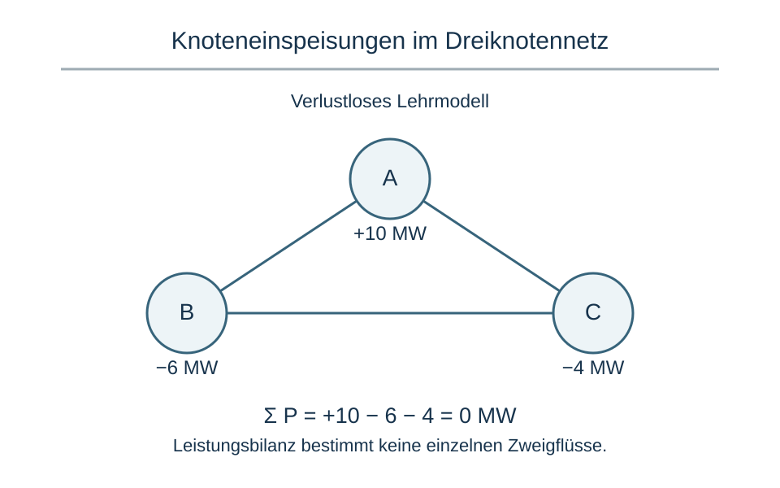

# M4-L1 – Knoten, Zweige und Netzzustand {#L1}

**Kursbereich:** M4 – Netzberechnung und Leistungsfluss  
**Niveau:** Bachelor · Aufbau/Wahlprofil  
**Vorwissen:** Grundlagen der elektrischen Größen und elementare Mathematik.  
**Lernziel:** Knotenleistungen mit einer einheitlichen Vorzeichenkonvention bilanzieren.

## Einstieg {#S1}

Leistungsfluss ist kein frei vorgegebener Pfeil auf der Landkarte. Er ergibt sich aus Netztopologie, komplexen Spannungen, Leitungsparametern und Einspeisungen. **Netzknoten** (buses) stellen elektrische Verbindungspunkte dar; **Zweige** sind Leitungen oder Transformatoren zwischen Knoten.

## Begriffe, Modell und Herleitung {#S2}

Für einen Netzknoten $i$ ist der eingespeiste komplexe Strom $I_i=\sum_jY_{ij}V_j$. Die Matrix $Y$ ist die Knotenadmittanzmatrix. Die komplexe Einspeiseleistung folgt aus $S_i=P_i+\mathrm jQ_i=V_i I_i^*$; $^*$ bezeichnet komplexe Konjugation. Je nach Zeichenkonvention gelten positive Werte für Einspeisung oder Verbrauch – diese Lektion setzt **Einspeisung positiv**.

Die reine Wirkleistungsbilanz eines verlustlosen Netzes lautet $\sum_iP_i=0$. In einem realen Netz ist die Summe der Erzeugerleistungen größer als die Summe der Verbrauchsleistungen, wenn ohmsche Verluste existieren. Ein Knoten wird beim AC-Lastfluss beispielsweise als Slack-/Referenz-, PV- oder PQ-Knoten modelliert; das definiert jeweils gegebene und zu berechnende Zustandsgrößen.

## Durchgerechnetes Beispiel {#S3}

In einem **verlustlosen** Dreiknotennetz speist A $10\,\mathrm{MW}$ ein. B entnimmt $6\,\mathrm{MW}$, C entnimmt $4\,\mathrm{MW}$. Mit Vorzeichen nach Einspeisung lauten die Knotenwerte $(+10,-6,-4)\,\mathrm{MW}$ und ihre Summe ist null. Aus dieser Bilanz allein folgt **nicht**, wie viel auf den einzelnen Leitungen A–B, A–C und B–C fließt: Dafür benötigt man die Netzimpedanzen und Spannungszustände.

### Vertiefung 1

In einem symmetrischen Dreiphasensystem werden eine gemeinsame Scheinleistungsbasis $S_B$ und je Spannungsebene eine Leiter-Leiter-Spannungsbasis $U_B$ gewählt. Daraus folgen $I_B=S_B/(\sqrt3 U_B)$ und $Z_B=U_B^2/S_B$. Eine Impedanz $Z$ wird durch $z=Z/Z_B$ dimensionslos. Die Spannungsbasen auf beiden Seiten eines idealen Transformators werden im Verhältnis der Nennspannungen gewählt. So kann der ideale Übersetzungsfaktor in der bezogenen Ersatzschaltung entfallen; reale Streuimpedanz und Verluste bleiben erhalten.

Beispiel: $S_B=10\,\mathrm{MVA}$, $U_B=20\,\mathrm{kV}$. Daraus ergeben sich $I_B=288{,}675\,\mathrm A$ und $Z_B=40\,\Omega$. Eine Serienimpedanz $2+\mathrm j4\,\Omega$ entspricht $0{,}05+\mathrm j0{,}10$ p.u. Bei einem Basiswechsel gilt $z_{neu}=z_{alt}(S_{B,neu}/S_{B,alt})(U_{B,alt}/U_{B,neu})^2$. Gleiche Spannung, doppelte Leistungsbasis: $z_{neu}=0{,}10+\mathrm j0{,}20$ p.u. Die physische Impedanz ändert sich dabei nicht.

## Selbstkontrolle {#S4}

### Aufgaben

1. In einem verlustfreien Modell sind zwei Verbraucher mit 5 MW und 7 MW vorhanden. Wie hoch muss die gesamte Erzeugung sein? Welcher Wert fehlt für einen realistischeren Bilanzschluss?
2. Zwei Lasten ziehen zusammen 8 MW; Netzverluste betragen im betrachteten Zustand 0,3 MW. Bestimme die notwendige Gesamteinspeisung.
3. Ermittle die Strom- und Impedanzbasis für 5 MVA und 10 kV.
4. Wie lautet die bezogene Impedanz einer Leitung mit $1+\mathrm j2\,\Omega$?

::: {.lc-solutions data-lc-section="S4"}
1. Die Gesamteinspeisung muss 12 MW betragen. Für reale Leitungsverluste wäre eine zusätzliche positive Erzeugungsleistung beziehungsweise ein Verlustmodell notwendig.
2. 8,3 MW; die Bilanz legt die Einzelzweigflüsse nicht fest.
3. $I_B=288{,}675\,\mathrm A$, $Z_B=20\,\Omega$.
4. $z=0{,}05+\mathrm j0{,}10$ p.u.
:::

## Annahmen, Sicherheit und Grenzen {#S5}

Das Admittanzmodell setzt einen geeigneten stationären sinusförmigen Betriebszustand voraus. Störfälle, Oberschwingungen und netzdynamische Vorgänge brauchen andere Modelle; hohe Spannungen dürfen nicht praktisch getestet werden.

## Zusammenfassung und Übergang {#S6}

Knotengleichungen verknüpfen Einspeisungen, Abnahmen und Leitungsflüsse. Eine linearisierte Betrachtung vereinfacht anschließend die Wirkflussanalyse.

**Weiterlesen:** [M4-L2 – Linearisierter DC-Lastfluss](M4-L2.md).

## Quellen (extern) {#S7}

- [KIT, Institut für Elektroenergiesysteme und Hochspannungstechnik – Elektrische Energienetze](https://www.ieh.kit.edu/2448_bee.php) · Inhaltsverzeichnis EEN (WS), Abschnitte 1–5; Drehstrom, Leistungsfluss, Netze, Fehler · Zuletzt abgerufen: 2026-11-23
- [TU Dresden, Fakultät Elektrotechnik und Informationstechnik – Wahlpflichtmodule ET, MT, IST, RES](https://tu-dresden.de/ing/elektrotechnik/studium/im_studium/lehrangebot/wahlpflichtmodule) · Planning of Electrical Power Systems / Fundamentals of Electrical Power Systems / Controlled Power Systems; Netzplanung, Netzberechnung, Betriebsmittel, Regelung · Zuletzt abgerufen: 2026-11-23
