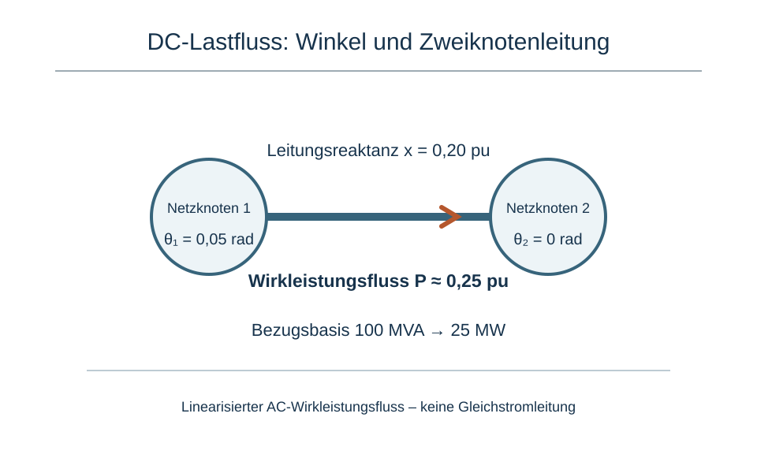

# M4-L2 – Linearisierter DC-Lastfluss {#L2}

**Kursbereich:** M4 – Netzberechnung und Leistungsfluss  
**Niveau:** Bachelor · Aufbau/Wahlprofil  
**Vorwissen:** Grundlagen der elektrischen Größen und elementare Mathematik.  
**Lernziel:** die Annahmen der DC-Lastflussnäherung nennen und einen pu-Leistungsfluss berechnen.

## Einstieg {#S1}

Ein vollständiger AC-Lastfluss ist nichtlinear. Für den schnellen Vergleich von Übertragungswegen wird oft die **DC-Lastflussnäherung** verwendet – trotz ihres Namens eine Näherung eines **Wechselstromnetzes**, keine Gleichstromübertragung. Sie ist nur unter klaren Annahmen zulässig.

## Begriffe, Modell und Herleitung {#S2}

Die Näherung setzt meist Spannungsbeträge von etwa $1$ per unit, kleine Winkelunterschiede, vernachlässigbare ohmsche Widerstände und Blindleistungsflüsse sowie symmetrischen Betrieb voraus. Dann ist für eine Leitung $i$–$j$ die per-unit-Wirkleistung $p_{ij}\approx(\theta_i-\theta_j)/x_{ij}$, wobei Winkel in Radiant und Reaktanz $x$ in per unit eingesetzt werden.

Mit einer geeigneten Referenzwinkelwahl lässt sich die Knoten-Wirkleistungsbilanz als lineares Gleichungssystem $B\boldsymbol\theta=\boldsymbol p$ schreiben. Das erlaubt sensitivitätsbasierte Engpassanalysen. Die Gleichung kann weder Spannungsprobleme noch Blindleistungsgrenzen oder ohmsche Verluste zuverlässig abbilden.

## Durchgerechnetes Beispiel {#S3}

Ein Zweiknotennetz habe die Leitungsreaktanz $x=0{,}20$ pu und den Winkelunterschied $\theta_1-\theta_2=0{,}05\,\mathrm{rad}$. Dann ist $p_{12}\approx0{,}05/0{,}20=0{,}25$ pu. Auf einer Basis von $S_\mathrm B=100\,\mathrm{MVA}$ entspricht das unter den Modellannahmen einer Wirk­leistung von $25\,\mathrm{MW}$. Per-unit-Basis, Vorzeichen und Winkelreferenz müssen stets angegeben werden.

### Vertiefung 1

Im DC-Lehrmodell eines verbundenen Netzes mit Serienreaktanzen $x_{ij}>0$ gilt $p_{ij}=(\theta_i-\theta_j)/x_{ij}$. Wir verwenden eine gemeinsame Basisleistung von 100 MVA, Winkel im Bogenmaß, Spannung 1 p.u., keine Verluste, Querzweige, Übersetzungsverhältnisse oder Phasenschieber. Der Referenzknoten A hat $\theta_A=0$. B entnimmt 30 MW und C 60 MW. Alle drei Kanten A–B, A–C und B–C haben $x=0{,}10$ p.u. Daraus folgt durch Knotenbilanz:

$$\begin{pmatrix}20&-10\\-10&20\end{pmatrix}\begin{pmatrix}\theta_B\\\theta_C\end{pmatrix}=\begin{pmatrix}-0{,}30\\-0{,}60\end{pmatrix}.$$

Die Lösung ist $\theta_B=-0{,}04$, $\theta_C=-0{,}05$. Die Zweigleistungen sind A→B 40 MW, A→C 50 MW und B→C 10 MW. B erhält netto 30 MW, C 60 MW; A liefert 90 MW. Eine Leitung mit gleicher Reaktanz trägt also nicht zwangsläufig dieselbe Leistung. Das Gleichungssystem ist erst mit der gewählten Winkelreferenz eindeutig lösbar. Bei einem elektrisch getrennten Netz braucht jede Insel eine eigene Referenz und eine konsistente Leistungsbilanz; ein nicht versorgter Verbrauch darf nicht rechnerisch verschwinden.

## Selbstkontrolle {#S4}

### Aufgaben

1. Verdoppelt sich in derselben DC-Näherung bei unverändertem Winkelunterschied die Leitungsreaktanz von 0,20 auf 0,40 pu, welcher Leistungsfluss ergibt sich?
2. Ein Zweig hat x=0,25 p.u. und Winkelunterschied −0,05 rad bei 100 MVA Basis. Berechne den gerichteten DC-Fluss.
3. Prüfe die Bilanz an B und C sowie den geschlossenen Winkelumlauf.
4. Was ändert sich bei identischen Einspeisungen, wenn sich alle Reaktanzen verdoppeln?

::: {.lc-solutions data-lc-section="S4"}
1. $p=0{,}05/0{,}40=0{,}125$ pu, auf der gleichen Basis $12{,}5\,\mathrm{MW}$. Dies gilt nur, solange sich die Winkelvorgaben im Modell nicht ändern.
2. −0,2 p.u. = −20 MW; entgegen der Bezugsrichtung.
3. B: $40-10=30$ MW; C: $50+10=60$ MW. Winkelumlauf A→B→C→A: $0{,}04+0{,}01-0{,}05=0$ rad.
4. Die Winkel werden −0,08 und −0,10 rad; die Zweigflüsse bleiben im linearen Modell gleich. Größere Winkel können die Modellnäherung verschlechtern.
:::

## Annahmen, Sicherheit und Grenzen {#S5}

Der DC-Lastfluss darf nicht zur Spannungsbewertung, zur Schutzdimensionierung oder für unsymmetrische/hochwiderständige Netze als exakte Methode verwendet werden. „DC“ bezeichnet die Linearisierung, nicht eine tatsächliche HGÜ-Leitung.

## Zusammenfassung und Übergang {#S6}

DC-Lastfluss bedeutet eine AC-Netz-Linearisierung mit festgehaltenen Spannungsbeträgen und ohne Blindleistungsrechnung. Die vollständigen AC-Gleichungen schließen diese Lücke teilweise.

**Weiterlesen:** [M4-L3 – AC-Lastfluss und Modellgrenzen](M4-L3.md).

## Quellen (extern) {#S7}

- [KIT, Institut für Elektroenergiesysteme und Hochspannungstechnik – Elektrische Energienetze](https://www.ieh.kit.edu/2448_bee.php) · Inhaltsverzeichnis EEN (WS), Abschnitte 1–5; Drehstrom, Leistungsfluss, Netze, Fehler · Zuletzt abgerufen: 2026-11-23
- [TU Dresden, Fakultät Elektrotechnik und Informationstechnik – Wahlpflichtmodule ET, MT, IST, RES](https://tu-dresden.de/ing/elektrotechnik/studium/im_studium/lehrangebot/wahlpflichtmodule) · Planning of Electrical Power Systems / Fundamentals of Electrical Power Systems / Controlled Power Systems; Netzplanung, Netzberechnung, Betriebsmittel, Regelung · Zuletzt abgerufen: 2026-11-23
- [MATPOWER – DC Power Flow](https://matpower.app/manual/matpower/DCPowerFlow.html) · § 4.2; reduzierte Knotenmatrix und Zweigflüsse · Zuletzt abgerufen: 2026-11-24
