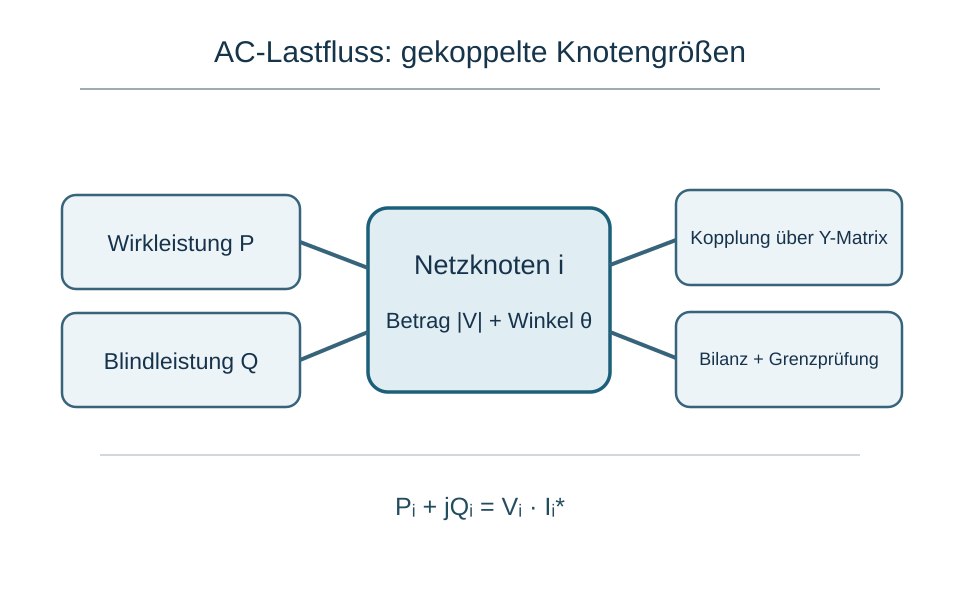

# M4-L3 – AC-Lastfluss und Modellgrenzen {#L3}

**Kursbereich:** M4 – Netzberechnung und Leistungsfluss  
**Niveau:** Bachelor · Aufbau/Wahlprofil  
**Vorwissen:** Grundlagen der elektrischen Größen und elementare Mathematik.  
**Lernziel:** P/Q-Knotenbilanzen und die Grenzen eines stationären AC-Lastflusses interpretieren.

## Einstieg {#S1}

Netzberechnung wird anspruchsvoller, sobald Spannungsbeträge, Wirk- und Blindleistung gleichzeitig berücksichtigt werden. Der **AC-Lastfluss** löst nichtlineare Gleichungen und zeigt, ob ein geplanter Zustand mit den gewählten Betriebsmittel- und Einspeisemodellen vereinbar ist.

## Begriffe, Modell und Herleitung {#S2}

Für die Knotenadmittanzen $Y_{ij}=G_{ij}+\mathrm jB_{ij}$ und $\theta_{ij}=\theta_i-\theta_j$ lauten die stationären Einspeisegleichungen

$$P_i=\sum_j |V_i||V_j|\left(G_{ij}\cos\theta_{ij}+B_{ij}\sin\theta_{ij}\right),$$

$$Q_i=\sum_j |V_i||V_j|\left(G_{ij}\sin\theta_{ij}-B_{ij}\cos\theta_{ij}\right).$$

Die Unbekannten sind insbesondere Spannungswinkel und -beträge. Newton-Verfahren linearisieren lokal über eine Jacobimatrix und iterieren bis die Bilanzabweichungen hinreichend klein sind. Eine numerische Konvergenz beweist jedoch weder Stabilität bei Störungen noch Zulässigkeit aller thermischen/regelungstechnischen Grenzen.

## Durchgerechnetes Beispiel {#S3}

Zur Plausibilitätskontrolle eines errechneten symmetrischen Lastpunkts seien $P=200\,\mathrm{kW}$, $Q=120\,\mathrm{kvar}$ und $U_\mathrm{LL}=400\,\mathrm V$ gegeben. Der Scheinleistungsbetrag ist $|S|=\sqrt{200^2+120^2}\approx233{,}24\,\mathrm{kVA}$. Für die symmetrische sinusförmige Last ergibt sich $I=|S|/(\sqrt3\,U_\mathrm{LL})\approx336{,}7\,\mathrm A$. Das ist nur eine rechnerische Lastpunktprüfung; ohne Leitungsdaten sagt der Wert nichts über zulässige Auslastung.

### Vertiefung 1

Ein Referenzknoten hat $V_1=1\angle0$ p.u. und speist über eine verlustfreie Serienreaktanz $X=0{,}2$ p.u. einen PQ-Lastknoten $V_2=v\angle\theta$. Die Last bezieht $p=0{,}5$ und $q=0{,}2$ p.u.; beide Zahlen sind positive Verbrauchswerte. Unter Einspeisekonvention gelten am Knoten 2 $-p=v\sin\theta/X$ und $-q=(v^2-v\cos\theta)/X$. Damit sind $v\sin\theta=-Xp$ und $v\cos\theta=v^2+Xq$. Quadrieren und Addieren ergibt für $y=v^2$ die quadratische Gleichung $y^2+(2Xq-1)y+X^2(p^2+q^2)=0$.

Die größere Wurzel liefert $y\approx0{,}9072136$, $v\approx0{,}95248$ und $\theta\approx-6{,}03^\circ$. Die zweite Wurzel entspricht einem sehr niedrigen Spannungsbetrag; daraus darf keine zulässige Betriebslösung abgeleitet werden. Der Referenzknoten liefert 0,5 p.u. Wirkleistung und ungefähr 0,26393 p.u. Blindleistung. Die Differenz zur Lastblindleistung ist der induktive Bedarf der Serienreaktanz. Bei 10 MVA Basis entspricht 0,5 p.u. genau 5 MW.

## Selbstkontrolle {#S4}

### Aufgaben

1. Warum kann ein numerisch konvergierter Leistungsfluss trotzdem physikalisch oder betrieblich unzulässig sein? Nenne zwei Gründe.
2. Ein reiner Serienzweig mit X=0,2 p.u. verbindet zwei Knoten mit Spannungsbetrag 1 p.u. und gleichem Winkel. Bestimme P und Q für den Zweig ohne Queradmittanz.
3. Setze die Hochspannungslösung in beide Einspeisegleichungen ein und prüfe das Vorzeichen.
4. Weshalb ist dieses Ergebnis kein Nachweis dynamischer Stabilität?

::: {.lc-solutions data-lc-section="S4"}
1. Beispielsweise sind Leitungen thermisch überlastet oder Spannungs- und Blindleistungsgrenzen verletzt; auch unplausible Modellparameter und fehlende Reglergrenzen können ein Ergebnis entwerten.
2. Kein Spannungsunterschied, daher I=0 und P=Q=0 an beiden Enden.
3. Es ergeben sich rund -0,5 p.u. und -0,2 p.u.; negative Einspeisung bedeutet Verbrauch.
4. Die Gleichungen beschreiben ausschließlich einen stationären Zustand. Regler-, Schutz- und dynamische Lastmodelle fehlen.
:::

## Annahmen, Sicherheit und Grenzen {#S5}

AC-Lastfluss ist eine quasistationäre Rechnung; dynamische Spannungsstabilität, Kurzschluss, Harmonische und transiente Phänomene brauchen eigene Analysen. Die Beispielspannung ist ausdrücklich kein normativ verallgemeinerter Anschlusswert.

## Zusammenfassung und Übergang {#S6}

AC-Lastfluss löst nichtlineare stationäre Bilanzen, aber weder Kurzschluss noch transiente Stabilität. Frequenzdynamik wird deshalb getrennt untersucht.

**Weiterlesen:** [M5-L1 – Frequenz und Leistungsungleichgewicht](M5-L1.md).

## Quellen (extern) {#S7}

- [KIT, Institut für Elektroenergiesysteme und Hochspannungstechnik – Elektrische Energienetze](https://www.ieh.kit.edu/2448_bee.php) · Inhaltsverzeichnis EEN (WS), Abschnitte 1–5; Drehstrom, Leistungsfluss, Netze, Fehler · Zuletzt abgerufen: 2026-11-23
- [TU Dresden, Fakultät Elektrotechnik und Informationstechnik – Wahlpflichtmodule ET, MT, IST, RES](https://tu-dresden.de/ing/elektrotechnik/studium/im_studium/lehrangebot/wahlpflichtmodule) · Planning of Electrical Power Systems / Fundamentals of Electrical Power Systems / Controlled Power Systems; Netzplanung, Netzberechnung, Betriebsmittel, Regelung · Zuletzt abgerufen: 2026-11-23
