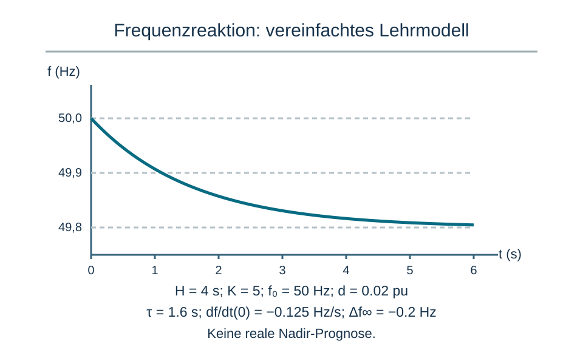

# M5-L1 – Frequenz und Leistungsungleichgewicht {#L1}

**Kursbereich:** M5 – Netzbetrieb, Dynamik und Schutz  
**Niveau:** Bachelor · Aufbau/Wahlprofil  
**Vorwissen:** Grundlagen der elektrischen Größen und elementare Mathematik.  
**Lernziel:** die anfängliche Frequenzänderungsrate einer idealisierten Swing-Gleichung berechnen.

## Einstieg {#S1}

In einem synchronen Wechselstromverbundsystem ist die Frequenz eine gemeinsame dynamische Größe. Wird schlagartig mehr Wirkleistung entnommen als zugeführt, verlangsamt sich der Rotationszustand synchroner Maschinen zunächst. Die Frequenz kann dann absinken, bevor Regel- und Reserveleistungen die Bilanz wieder verbessern.

## Begriffe, Modell und Herleitung {#S2}

Eine stark vereinfachte aggregierte Swing-Gleichung lautet $2H\,\mathrm d(f/f_0)/\mathrm dt=\Delta P_\mathrm{pu}$, wobei $H$ die Trägheitskonstante in Sekunden, $f_0$ die nominale Bezugsfrequenz und $\Delta P_\mathrm{pu}$ die Netto-Wirkleistungsänderung auf einer zugehörigen Leistungsbasis bezeichnet. Das Vorzeichen ist für Erzeugungsüberschuss positiv. Damit ergibt sich anfänglich $\mathrm df/\mathrm dt=f_0\Delta P_\mathrm{pu}/(2H)$, **ohne** Dämpfung oder Reglerreaktion.

Die trägheitsbedingte Erstreaktion ist von Frequenzhaltungs- und Wiederherstellungsleistungen zu trennen. Moderne Systeme können regelbare Erzeugung, flexible Lasten und geeignete Wechselrichterressourcen einsetzen. Ihre tatsächlichen Anforderungen und Produkte hängen vom jeweiligen Synchrongebiet und den geltenden Regeln ab. Frequenz allein erlaubt keine Bestimmung des Engpasses an einer einzelnen Leitung.

**Bezugsbasis:** Im aggregierten Modell müssen die per-unit-Leistungsabweichung und die Trägheitskonstante dieselbe Leistungsbasis verwenden. Wird aus mehreren Maschinen aggregiert, geht deren jeweilige Trägheit leistungsgerecht in eine gemeinsame Konstante ein. Die eingesetzte konstante Größe $H$ ist keine automatisch verfügbare Eigenschaft jedes netzgekoppelten Umrichters.

## Durchgerechnetes Beispiel {#S3}

Ein aggregiertes **Lehrmodell** mit $f_0=50\,\mathrm{Hz}$, $H=4\,\mathrm s$ und einem anfänglichen Defizit $\Delta P_\mathrm{pu}=-0{,}02$ ergibt $\mathrm df/\mathrm dt=50(-0{,}02)/(2\cdot4)=-0{,}125\,\mathrm{Hz/s}$. Dieser Wert beschreibt nur die anfängliche Steigung. Eine Fortsetzung der Gerade über längere Zeit würde die Regler- und Lastreaktion ignorieren und ist daher keine reale Frequenzprognose.

### Vertiefung 1

**Lernziel:** Anfangssteigung, stationäre Abweichung und Zeitkonstante unterscheiden.

Erweitert wird das vorhandene aggregierte Swing-Modell um einen idealisierten proportionalen Gegenbeitrag. Sei $x=(f-f_0)/f_0$ die dimensionslose Frequenzabweichung. Für ein konstantes Leistungsdefizit $d>0$ in pu gilt $2H\dot x=-d-Kx$. $K>0$ bezeichnet die zusammengefasste statische Wirkung von frequenzabhängiger Last und sofortiger proportionaler Leistungsreaktion, jeweils in pu Leistung pro pu Frequenzabweichung. Bei $x(0)=0$ ergibt die lineare Differentialgleichung $x(t)=-(d/K)(1-\exp(-Kt/(2H)))$. Die Zeitkonstante ist $\tau=2H/K$, die Frequenzabweichung im Grenzwert $\Delta f_\infty=-f_0d/K$.

Mit $H=4\,\mathrm s$, $f_0=50\,\mathrm{Hz}$, $d=0{,}02$ und $K=5$ folgt eine Anfangssteigung von −0,125 Hz/s, eine Zeitkonstante von 1,6 s und eine stationäre Abweichung von −0,2 Hz. Nach 1,6 s beträgt die Frequenz rund 49,874 Hz; nach 4,8 s rund 49,810 Hz. Der Modellverlauf ist monoton und nähert sich 49,8 Hz. Ohne Rückkopplung ($K=0$) würde das Modell stattdessen eine Gerade liefern. Der Grenzübergang ist für endliche Zeit sinnvoll, ein stationärer Wert für K=0 dagegen nicht.

Die sofortige Rückkopplung ist eine didaktische Idealisierung; reale Regler haben Verzögerungen, Leistungsbegrenzungen und weitere Zustandsgrößen. Das Modell sagt daher keinen realen Frequenznadir voraus und bildet die Wiederherstellung der Nennfrequenz durch zusätzliche Regelung nicht ab. Die Leistungsbasis entspricht der vorhandenen Lektion. Keine betrieblichen Einstellwerte.

## Selbstkontrolle {#S4}

### Aufgaben

1. Was ist nach derselben vereinfachten Gleichung die anfängliche Frequenzänderungsrate bei verdoppelter Trägheitskonstante H = 8 s und unverändertem Defizit?
2. Ein aggregiertes Lehrmodell hat f0=50 Hz, H=5 s, anfängliches Leistungsdefizit 0,03 p.u. Bestimme die anfängliche Frequenzsteigung.
3. Wie ändern sich Zeitkonstante und stationäre Abweichung bei H=8 s?
4. Wie ändern sie sich bei K=10 und H=4 s?
5. Warum ist der Modellendwert kein realer Frequenznadir?

::: {.lc-solutions data-lc-section="S4"}
1. $\mathrm df/\mathrm dt=50(-0{,}02)/(2\cdot8)=-0{,}0625\,\mathrm{Hz/s}$. Der Anfangsabfall ist im vereinfachten Modell halb so groß. Daraus folgt nicht, dass eine beliebige Anlage die Frequenz auf einem bestimmten Wert hält.
2. −0,15 Hz/s; keine lineare Langzeitprognose.
3. 3,2 s und unverändert −0,2 Hz.
4. 0,8 s und −0,1 Hz. Die Anfangssteigung bleibt −0,125 Hz/s.
5. Dynamische Verzögerungen und Begrenzungen fehlen; reale Systeme können zunächst stärker absinken und anschließend wieder ansteigen.
:::

## Annahmen, Sicherheit und Grenzen {#S5}

50 Hz ist hier der Bezugswert eines beispielhaften kontinentaleuropäischen Synchronnetzes, kein weltweit geltender Netzstandard. Frequenzschutzwerte, Reserveanforderungen und automatische Schalthandlungen werden nicht abgeleitet. Netzstabilität ist eine sicherheitskritische Betreiberaufgabe.

## Zusammenfassung und Übergang {#S6}

Das anfängliche Leistungsdefizit beeinflusst über die modellierte Trägheit die Frequenzänderungsrate. Engpassmanagement dagegen betrifft die räumliche Verteilung der Leistung.

**Weiterlesen:** [M5-L2 – Reserve, Engpässe und Redispatch](M5-L2.md).

## Quellen (extern) {#S7}

- [KIT, Institut für Elektroenergiesysteme und Hochspannungstechnik – Elektrische Energienetze](https://www.ieh.kit.edu/2448_bee.php) · Inhaltsverzeichnis EEN (WS), Abschnitte 1–5; Drehstrom, Leistungsfluss, Netze, Fehler · Zuletzt abgerufen: 2026-11-23
- [TU Dresden, Fakultät Elektrotechnik und Informationstechnik – Wahlpflichtmodule ET, MT, IST, RES](https://tu-dresden.de/ing/elektrotechnik/studium/im_studium/lehrangebot/wahlpflichtmodule) · Planning of Electrical Power Systems / Fundamentals of Electrical Power Systems / Controlled Power Systems; Netzplanung, Netzberechnung, Betriebsmittel, Regelung · Zuletzt abgerufen: 2026-11-23
