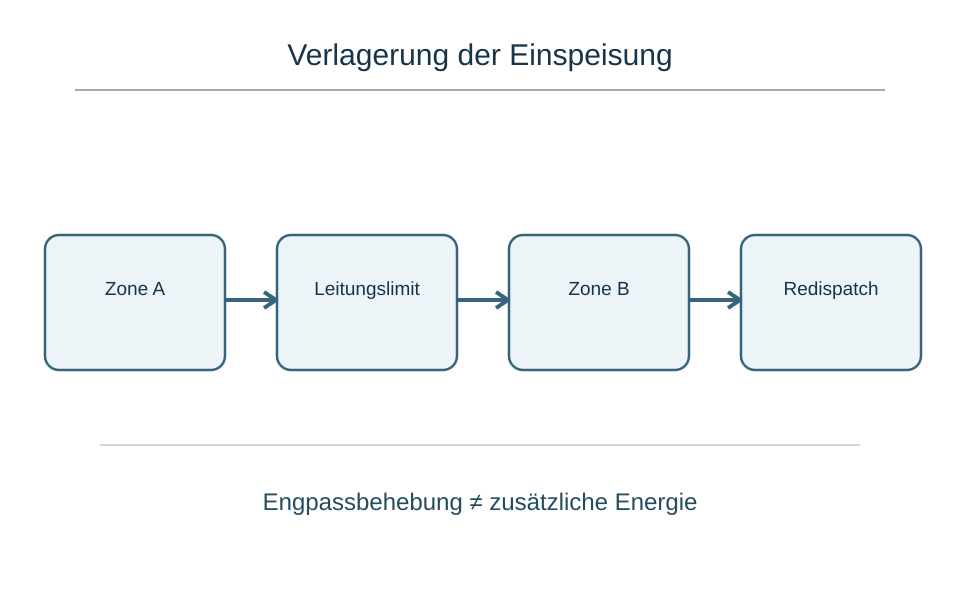

# M5-L2 – Reserve, Engpässe und Redispatch {#L2}

**Kursbereich:** M5 – Netzbetrieb, Dynamik und Schutz  
**Niveau:** Bachelor · Aufbau/Wahlprofil  
**Vorwissen:** Grundlagen der elektrischen Größen und elementare Mathematik.  
**Lernziel:** einen verlustfreien Zweizonen-Redispatch bilanzieren und von Frequenzregelung abgrenzen.

## Einstieg {#S1}

Eine ausgeglichene Leistungssumme garantiert noch keine sicheren Leitungsflüsse. Wird die Transportkapazität eines Netzabschnitts überschritten, müssen Einspeisungen, Verbräuche oder Netzschaltungen in geeigneter Weise verändert werden. **Redispatch** verändert den Ort der Einspeisung, während die Gesamtbilanz möglichst erhalten bleibt.

## Begriffe, Modell und Herleitung {#S2}

Im vereinfachten Zweizonenmodell sei die Bilanz $P_{G,A}+P_{G,B}=P_{L,A}+P_{L,B}+P_\mathrm{Verlust}$. Vernachlässigt man Verluste und lokale Lasten in A, überträgt die Verbindung ungefähr $P_{A\to B}=P_{G,A}$. Ist die Grenze $P_\mathrm{max}$ kleiner als dieser Fluss, können $\Delta P_{G,A}<0$ und $\Delta P_{G,B}>0$ mit $\Delta P_{G,A}+\Delta P_{G,B}=0$ den Engpass entschärfen.

**Regelleistung** korrigiert eine System-Wirkleistungsbilanz beziehungsweise Frequenzabweichung; **Redispatch** löst vor allem räumliche Engpässe. Beide Maßnahmen können unterschiedliche Anlagen, Zeiträume und Regeln betreffen. Die Bundesnetzagentur beschreibt Redispatch als Anpassung von Erzeugungsleistungen zur Entlastung von Leitungsabschnitten; spezifische rechtliche Verfahren sind zeitabhängig.

## Durchgerechnetes Beispiel {#S3}

In einer **verlustlosen Modellwelt** verbraucht Zone B $100\,\mathrm{MW}$. Zone A erzeugt $80\,\mathrm{MW}$ und Zone B $20\,\mathrm{MW}$. Die Verbindungsleitung kann höchstens $70\,\mathrm{MW}$ tragen; ursprünglicher Fluss wäre $80\,\mathrm{MW}$. Reduziert man Erzeugung in A um $15\,\mathrm{MW}$ auf 65 MW und erhöht sie in B um 15 MW auf 35 MW, bleibt die Erzeugung 100 MW, während die Modellleitung 65 MW führt. Ob diese Änderung technisch und wirtschaftlich möglich ist, ist separat zu belegen.

## Selbstkontrolle {#S4}

### Aufgaben

1. Welche minimale paarige Verlagerung wäre für dasselbe Lehrmodell erforderlich, um den Fluss von 80 MW gerade auf die Grenze von 70 MW zu bringen?
2. Zone A liefert 55 MW an B, die fiktive Grenze beträgt 45 MW. Welche minimale paarige Erzeugungsänderung ist im verlustfreien Zweizonenmodell erforderlich?

::: {.lc-solutions data-lc-section="S4"}
1. Erzeugung in A um 10 MW senken und in B um 10 MW erhöhen. Im Modell bleibt die Gesamtbilanz erhalten, und der Fluss sinkt auf 70 MW; tatsächliche Reserve- und Netzrestriktionen bleiben unberücksichtigt.
2. A −10 MW, B +10 MW; Gesamtleistung unverändert.
:::

## Annahmen, Sicherheit und Grenzen {#S5}

Die Darstellung ist eine vereinfachte physikalische Erklärung, keine gesetzliche Redispatch-Anleitung. Rechtsgrundlagen, Abrufverfahren, Vergütung und konkrete Kapazitäten sind landes-, netz- und zeitabhängig.

## Zusammenfassung und Übergang {#S6}

Redispatch verändert die räumliche Einspeisungsverteilung bei erhaltener Gesamtbilanz. Netzfehler verlangen zusätzlich selektive Schutzkonzepte.

**Weiterlesen:** [M5-L3 – Fehlerzustände und Schutzprinzipien](M5-L3.md).

## Quellen (extern) {#S7}

- [Bundesnetzagentur – Redispatch](https://www.bundesnetzagentur.de/DE/Fachthemen/ElektrizitaetundGas/Versorgungssicherheit/Netzengpassmanagement/Engpassmanagement/Redispatch/artikel.html) · Einleitung und Redispatch-Abschnitte; Netzengpass, Eingriff in Erzeugungsleistung, Blindleistung · Zuletzt abgerufen: 2026-11-23
- [KIT, Institut für Elektroenergiesysteme und Hochspannungstechnik – Elektrische Energienetze](https://www.ieh.kit.edu/2448_bee.php) · Inhaltsverzeichnis EEN (WS), Abschnitte 1–5; Drehstrom, Leistungsfluss, Netze, Fehler · Zuletzt abgerufen: 2026-11-23
