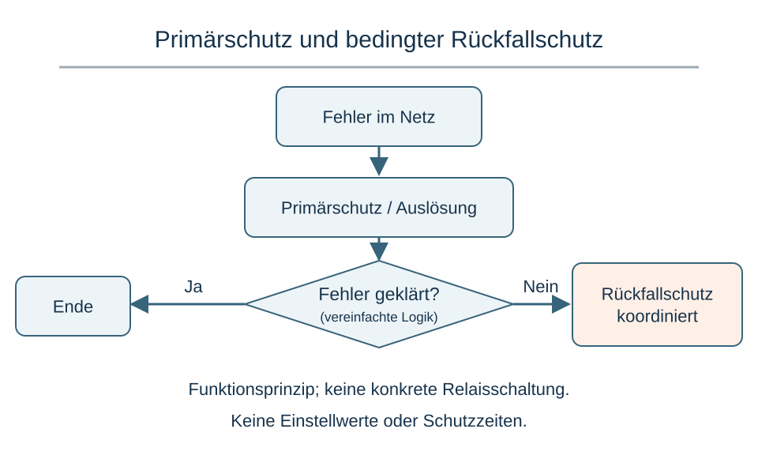

# M5-L3 – Fehlerzustände und Schutzprinzipien {#L3}

**Kursbereich:** M5 – Netzbetrieb, Dynamik und Schutz  
**Niveau:** Bachelor · Aufbau/Wahlprofil  
**Vorwissen:** Grundlagen der elektrischen Größen und elementare Mathematik.  
**Lernziel:** ein vereinfachtes Thevenin-Fehlermodell berechnen und Selektivität begründen.

## Einstieg {#S1}

Kurzschlüsse verändern Spannungen und Ströme in sehr kurzer Zeit. Der Netzschutz soll Fehler erkennen und fehlerhafte Abschnitte gezielt von der Versorgung trennen. Wichtig sind **Selektivität** (möglichst nur den betroffenen Bereich trennen), **Schnelligkeit**, **Empfindlichkeit** und **Zuverlässigkeit**. Die Auslegung hängt stark von tatsächlichen Netzeigenschaften ab.

## Begriffe, Modell und Herleitung {#S2}

Ein sehr einfaches stationäres Ersatzmodell verwendet den Thevenin-Ersatz der Quelle: $I_\mathrm{k}=U_\mathrm{Th}/|Z_\mathrm{Th}+Z_\mathrm{Fehler}|$. Die Formel beschreibt lediglich einen idealisierten symmetrischen oder einphasigen Fehlerfall und ignoriert zahlreiche dynamische Effekte. Der Fehlerstrom kann andere Werte als der normale Betriebsstrom annehmen. In einem mehrphasigen Netz sind die Fehlerart, Netzerderung, Generator- und Umrichterbeiträge sowie zeitlicher Verlauf entscheidend.

Schutzsysteme verwenden Messgrößen wie Strom, Spannung und gegebenenfalls Richtung oder Impedanz. **Schutzstaffelung** bedeutet, dass eine primäre Schutzeinrichtung zuerst die zugehörige Zone behandelt, während ein unabhängiger Rückfallschutz bei Versagen bereitsteht. Die konkrete Koordination muss mit gültigen Regeln und realen Geräten geprüft werden.

## Durchgerechnetes Beispiel {#S3}

Für ein ausdrücklich **hypothetisches** einphasiges Thevenin-Modell seien $U_\mathrm{Th}=230\,\mathrm V$, $R=0{,}10\,\Omega$ und $X=0{,}30\,\Omega$ gegeben; die zusätzliche Fehlerimpedanz werde zu null angenommen. $|Z|=\sqrt{0{,}10^2+0{,}30^2}\approx0{,}316\,\Omega$. Der Strombetrag ist etwa $I_\mathrm{k}=230/0{,}316\approx727\,\mathrm A$. Daraus darf **keine** Sicherungsgröße oder Schutz-Einstellzeit abgeleitet werden.

### Vertiefung 1

Mit $a=\exp(\mathrm j2\pi/3)$ lassen sich drei komplexe Stranggrößen in Null-, Mit- und Gegensystem zerlegen. Für Spannungen gilt $V_0=(V_a+V_b+V_c)/3$, $V_1=(V_a+aV_b+a^2V_c)/3$ und $V_2=(V_a+a^2V_b+aV_c)/3$. Die Rücktransformation lautet $V_a=V_0+V_1+V_2$, $V_b=V_0+a^2V_1+aV_2$, $V_c=V_0+aV_1+a^2V_2$. Das Verfahren ist linear und gilt für Zeiger gleicher Frequenz; für eine Fehlerrechnung sind anschließend die jeweiligen Netze und deren Kopplung entsprechend der Fehlerart erforderlich.

Beispiel: $V_a=1$, $V_b=0$, $V_c=0$ p.u. Alle drei Komponenten haben den Wert 1/3 p.u. Der Beispielzustand dient ausschließlich der Transformation, nicht als realer Kurzschlussbetriebspunkt.

## Selbstkontrolle {#S4}

### Aufgaben

1. Warum kann eine Abschaltung des gesamten Netzes bei jedem einzelnen Fehler zwar den Fehler isolieren, aber trotzdem ein schlechtes Schutzkonzept sein?
2. In einem hypothetischen Thevenin-Modell ist die Spannung vor dem Fehler unverändert, der Betrag der Gesamtimpedanz verdoppelt sich. Wie ändert sich der modellierte Fehlerstrombetrag?
3. Zerlege $V_a=1$, $V_b=a^2$, $V_c=a$.
4. Warum kann man eine unsymmetrische Störung nicht generell mit nur einer Mitsystemimpedanz berechnen?

::: {.lc-solutions data-lc-section="S4"}
1. Sie verletzt oft das Selektivitätsziel und verursacht unnötige Unterbrechungen für nicht betroffene Teile. Die tatsächliche Schutzkoordination muss Ausfallarten, Rückfallschutz und Betriebsmittelgrenzen berücksichtigen.
2. Er halbiert sich; kein Nachweis einer Schutzdimensionierung oder zulässigen Berührungsspannung.
3. $V_1=1$, $V_0=V_2=0$.
4. Andere Komponentennetze können durch die Fehlerbedingungen gekoppelt sein; insbesondere Erdung und Nullsystem beeinflussen Erdfehler. Reale Schutzbemessung erfordert zusätzliche norm- und anlagenspezifische Modelle.
:::

## Annahmen, Sicherheit und Grenzen {#S5}

**Lebensgefahr:** Keine Kurzschlussversuche, Sicherungsprüfungen oder Arbeiten an Netz-/Hochspannungsanlagen. Das Modell ersetzt keine Norm, Netzberechnung, Schutzprüfung oder Fachkraft.

## Zusammenfassung und Übergang {#S6}

Schutztechnik muss Fehlerfälle erkennen, selektiv abschalten und Rückfallschutz vorsehen. Ihre Wirkung setzt belastbare Mess- und Zustandsdaten voraus.

**Weiterlesen:** [M6-L1 – Messdaten und Netzzustandsschätzung](M6-L1.md).

## Quellen (extern) {#S7}

- [KIT, Institut für Elektroenergiesysteme und Hochspannungstechnik – Elektrische Energienetze](https://www.ieh.kit.edu/2448_bee.php) · Inhaltsverzeichnis EEN (WS), Abschnitte 1–5; Drehstrom, Leistungsfluss, Netze, Fehler · Zuletzt abgerufen: 2026-11-23
- [TU Dresden, Fakultät Elektrotechnik und Informationstechnik – Wahlpflichtmodule ET, MT, IST, RES](https://tu-dresden.de/ing/elektrotechnik/studium/im_studium/lehrangebot/wahlpflichtmodule) · Planning of Electrical Power Systems / Fundamentals of Electrical Power Systems / Controlled Power Systems; Netzplanung, Netzberechnung, Betriebsmittel, Regelung · Zuletzt abgerufen: 2026-11-23
- [Universität Stuttgart – Prüfungsordnung Nr. 36/2025](https://www.uni-stuttgart.de/universitaet/aktuelles/bekanntmachungen/Amtliche-Bekanntmachung-Nummer-36-2025/) · Anlage 2, § 5 Abs. 2 a), Stromnetz-/Erneuerbaren-Module im gewählten Bachelor-Wahlbereich · Webansicht geprüft: 2026-11-23
