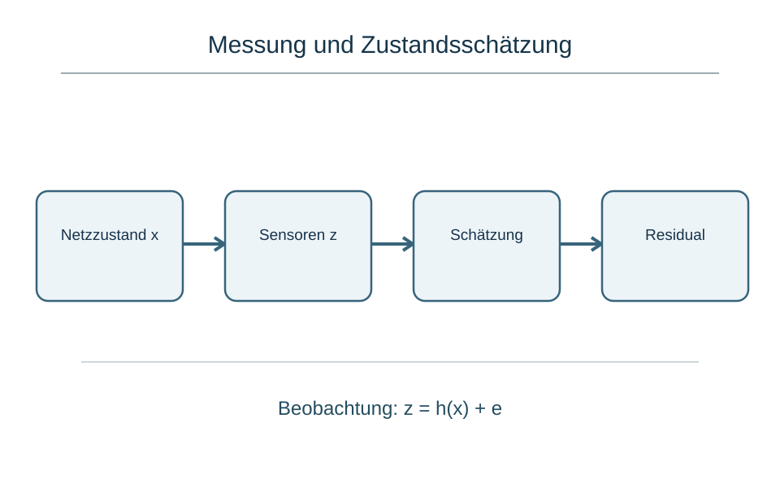

# M6-L1 – Messdaten und Netzzustandsschätzung {#L1}

**Kursbereich:** M6 – Digitalisierung, Sicherheit und Resilienz  
**Niveau:** Bachelor · Aufbau/Wahlprofil  
**Vorwissen:** Grundlagen der elektrischen Größen und elementare Mathematik.  
**Lernziel:** Messwertmodell, Netzzustand und Residuum einer Schätzung voneinander unterscheiden.

## Einstieg {#S1}

Netzbetreiber kennen den Netzzustand nicht vollständig aus einem einzigen Messwert. Sensoren liefern Spannungen, Ströme, Leistungen oder Schalterstellungen an bestimmten Orten. Die **Zustandsschätzung** rekonstrui daraus einen konsistenten Satz von Knotenspannungen und anderen Zustandsgrößen – soweit Messanordnung und Modell das zulassen.

## Begriffe, Modell und Herleitung {#S2}

In einem lokal linearisierten Modell sei der Messvektor $\boldsymbol z=H\boldsymbol x+\boldsymbol\varepsilon$, wobei $\boldsymbol x$ die gesuchten Zustände, $H$ die Messabbildung und $\boldsymbol\varepsilon$ Messfehler bezeichnet. Bei bekannten Messunsicherheiten verwendet man etwa gewichtete kleinste Quadrate: $\hat{\boldsymbol x}=\arg\min_{\boldsymbol x}(\boldsymbol z-H\boldsymbol x)^TW(\boldsymbol z-H\boldsymbol x)$. Dafür muss das System in den relevanten Zuständen **beobachtbar** sein; die erforderliche Rangbedingung hängt von Modell und Referenz ab.

Plausibilitätsprüfungen können widersprüchliche Messwerte aufdecken. Ein kleiner Restfehler beweist jedoch nicht, dass alle Daten echt oder unverfälscht sind. Ebenso sind zeitliche Synchronisation, Topologieänderungen, Qualitätssicherung und Datenschutz wichtig.

Für unkorrelierte Messfehler mit bekannten Varianzen $\sigma_i^2$ ist die Gewichtsmatrix im einfachen Modell $W=\operatorname{diag}(1/\sigma_i^2)$. Bei korrelierten Fehlern muss stattdessen die passende inverse Kovarianzmatrix betrachtet werden. Die bloße Anzahl der Messungen garantiert weder Unabhängigkeit noch Beobachtbarkeit.

## Durchgerechnetes Beispiel {#S3}

Drei unabhängig gedachte Sensoren melden für dieselbe konstante Modellspannung $229$, $230$ und $231\,\mathrm V$ bei gleicher angenommener Genauigkeit. Der Mittelwert, der die Summe quadratischer Abweichungen minimiert, ist $\hat U=(229+230+231)/3=230\,\mathrm V$. Die Abweichungen sind $-1$, $0$ und $+1\,\mathrm V$. Eine zusätzliche Messung oder ein physikalisch konsistentes Mehrknotenmodell könnte die Schätzung verändern.

### Vertiefung 1

Für drei unabhängige unverzerrte Messungen derselben konstanten Spannung mit bekannten Standardabweichungen $\sigma_i$ minimieren wir $J(u)=\sum_i(z_i-u)^2/\sigma_i^2$. Setzt man $\mathrm dJ/\mathrm du=0$, erhält man $\hat u=\sum_i w_i z_i/\sum_i w_i$ mit $w_i=1/\sigma_i^2$. Der Schätzer ist bei diesen Modellannahmen unverzerrt; seine Varianz ist $1/\sum_iw_i$. Bei $z=(229,230,235)$ V und $\sigma=(1,1,5)$ V ist der ungewichtete Mittelwert 231,333 V, der gewichtete 229,608 V. Die Standardabweichung des Schätzers beträgt etwa 0,700 V. Der dritte Messwert hat geringeres Gewicht; er wird nicht allein deshalb verworfen. Die Residuen $z_i-\hat u$ sind rund −0,608 V, +0,392 V und +5,392 V.

Bei einem realen Netzzustandsschätzer ist $u$ durch einen Zustandsvektor (z. B. Spannungswinkel und -beträge) und die direkte Messgleichung durch eine im Allgemeinen nichtlineare Funktion $h(x)$ zu ersetzen. Korrelationen erfordern eine geeignete Kovarianzmatrix statt unabhängiger Gewichte. Ein kleiner Zielfunktionswert ist kein Beweis korrekter Topologie oder unverfälschter Messungen.

## Selbstkontrolle {#S4}

### Aufgaben

1. Wenn einer von drei gleich gewichteten Sensorwerten auf 260 V springt, während die beiden anderen 229 und 230 V anzeigen, was zeigt der neue Mittelwert? Was wäre ein sinnvoller nächster Qualitätsprüfungsschritt?
2. Zwei gleich gewichtete Sensoren derselben Größe melden 98 und 102 Einheiten. Bestimme die Schätzung und beide Residuen (Messung minus Schätzung).
3. Wie ändert sich das Ergebnis bei gleichen Standardabweichungen aller drei Messwerte?
4. Warum ist die Angabe einer kleinen Schätzervarianz allein kein Nachweis korrekter Messdaten?

::: {.lc-solutions data-lc-section="S4"}
1. $(229+230+260)/3\approx239{,}67\,\mathrm V$. Der Wert ist stark durch den Ausreißer verzerrt. Residuen, Sensorstatus und ggf. robuste Schätzverfahren wären zu prüfen; kein Sensor wird allein aufgrund der Abweichung automatisch als defekt erklärt.
2. 100; −2 und +2. Ein gemeinsamer Offset wäre dadurch nicht nachweisbar.
3. Alle Gewichte sind gleich, der Schätzer ist das arithmetische Mittel 231,333 V.
4. Die Varianz gilt nur im angenommenen Fehlermodell. Gemeinsame systematische Fehler, Korrelationen oder ein falsches Modell können den Schätzer verzerren.
:::

## Annahmen, Sicherheit und Grenzen {#S5}

Ein kleines Beispiel zur Mittelwertbildung ist noch kein echter Netz-State-Estimator. Vollständige Beobachtbarkeit, Nichtlinearität, Datenauthentizität und realer Betrieb sind gesondert zu validieren.

## Zusammenfassung und Übergang {#S6}

Eine Zustandsabschätzung prüft Konsistenz von Messung und Netzmodell, ist aber nicht identisch mit einem verifizierten physikalischen Zustand. Datenherkunft und IT/OT-Schutz ergänzen die Betrachtung.

**Weiterlesen:** [M6-L2 – Digitale Netze und Kommunikationsrisiken](M6-L2.md).

## Quellen (extern) {#S7}

- [KIT, Institut für Elektroenergiesysteme und Hochspannungstechnik – Elektrische Energienetze](https://www.ieh.kit.edu/2448_bee.php) · Inhaltsverzeichnis EEN (WS), Abschnitte 1–5; Drehstrom, Leistungsfluss, Netze, Fehler · Zuletzt abgerufen: 2026-11-23
- [Universität Stuttgart, Fakultät 5 – Electrical Power Systems](https://www.f05.uni-stuttgart.de/ei/studiengaenge/eeng/uebersicht/Electrical-Power-Systems/) · Studiengangsschwerpunkt Electrical Power Systems; Erzeugung, Verteilung, nachhaltige und zuverlässige Netze · Zuletzt abgerufen: 2026-11-23
- [pandapower – State Estimation](https://pandapower.readthedocs.io/en/stable/estimation.html) · Theoretical Background; Messunsicherheit und Zustandsschätzung · Zuletzt abgerufen: 2026-11-24
