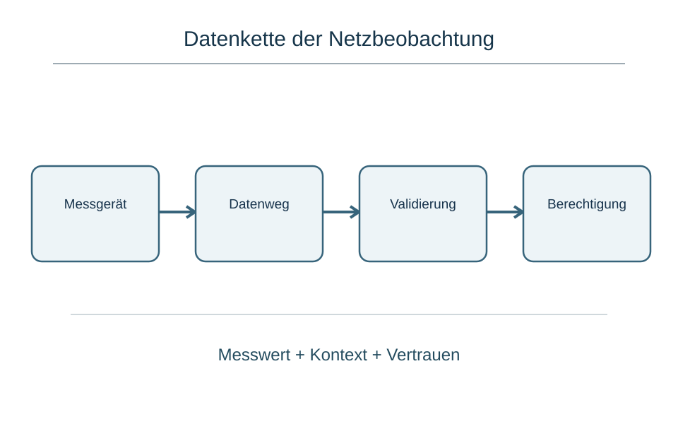

# M6-L2 – Digitale Netze und Kommunikationsrisiken {#L2}

**Kursbereich:** M6 – Digitalisierung, Sicherheit und Resilienz  
**Niveau:** Bachelor · Aufbau/Wahlprofil  
**Vorwissen:** Grundlagen der elektrischen Größen und elementare Mathematik.  
**Lernziel:** Messdaten hinsichtlich Zeitbezug, Einheit, Herkunft und Vertrauenswürdigkeit prüfen.

## Einstieg {#S1}

Digitale Netzführung verbindet Messgeräte, Datenübertragung, Zustandsschätzung und Leitentscheidungen. Dadurch entstehen neue Beobachtungs- und Steuerungsmöglichkeiten, aber auch Abhängigkeiten von Zeitquellen, Software, Kommunikationsverbindungen und Identitätsverwaltung. Eine Messung ist erst dann verwertbar, wenn **Zeitbezug, Einheit, Herkunft und Qualität** bekannt sind.

## Begriffe, Modell und Herleitung {#S2}

Eine sichere konzeptionelle Datenkette umfasst: (1) Sensor mit kalibriertem Messbereich; (2) Zeitstempel und lokale Vorverarbeitung; (3) authentifizierte Übertragung über getrennte Kommunikationszonen; (4) Validierung und Zustandsmodell; (5) autorisierte Anzeige/Entscheidung. Daten dürfen niemals allein aufgrund eines plausiblen Zahlenwertes als vertrauenswürdig gelten. Die Unterscheidung zwischen Monitoring, Planung und tatsächlich wirksamer Regelung muss erhalten bleiben.

Ein Netz kann fachlich korrekte Regelalgorithmen haben und trotzdem durch falsche Daten zu falschen Entscheidungen gelangen. Sinnvolle Maßnahmen sind Zugriffsbegrenzung, mehrstufige Freigabe, Änderungsprotokolle, sichere Zeitbasis, Redundanz und Rückfallbetrieb. Die konkrete Umsetzung folgt den jeweils anwendbaren IT-/OT-Sicherheitsanforderungen; dieses Modul enthält keine Angriffs- oder Umgehungsanleitung.

## Durchgerechnetes Beispiel {#S3}

Ein Messsystem sendet 4,0 MW, aber sein Zeitstempel liegt 20 Minuten zurück. Ein zweites System meldet aktuell 6,0 MW. Für eine Momentanbilanz darf man die beiden Werte nicht blind addieren. Zuerst müssen Zeitpunkt, Intervall und Einheit verglichen werden. Der erste Wert kann für eine historische Analyse brauchbar sein, nicht zwangsläufig für den aktuellen Netzzustand.

## Selbstkontrolle {#S4}

### Aufgaben

1. Nenne drei Metadaten, ohne die ein Leistungsmesswert nicht eindeutig in eine Netzbilanz übernommen werden kann. Warum ist ein gültiger Zeitstempel allein nicht ausreichend?
2. Ein Messwert ist als 2 MW, 15-Minuten-Mittel, ein anderer als 2 MWh im selben Intervall angegeben. Sind sie gleichwertig?

::: {.lc-solutions data-lc-section="S4"}
1. Mindestens Messort beziehungsweise Zuordnung, Einheit und Messzeit/-intervall; außerdem Richtung/Zeichen und Qualität. Ein Zeitstempel beweist weder Authentizität noch Kalibrierung oder korrekte Netztopologie.
2. Nein. 2 MW über 15 min = 0,5 MWh; 2 MWh entsprechen 8 MW Mittelwert.
:::

## Annahmen, Sicherheit und Grenzen {#S5}

Allgemeine Verteidigungsprinzipien ersetzen keine Sicherheitszertifizierung oder aktuelle branchenspezifische Pflichtnorm. Aktive Netzsteuerung bleibt autorisierten Betreibern vorbehalten.

Zur Einordnung aktueller digitaler Verfahren: Die Internationale Energieagentur beschreibt im Bericht *Modernising Grids in the Age of Electricity* vom **21.09.2026** den Nutzen digitaler Netztechnologien insbesondere für Beobachtbarkeit, Prognosen, Optimierung und Risikomanagement. Diese übergeordnete Bewertung ist weder eine Zertifizierung eines konkreten Systems noch ein Nachweis der Datensicherheit.

## Zusammenfassung und Übergang {#S6}

Korrekte Regelalgorithmen erfordern gültige und vertrauenswürdige Daten. Auch mit Redundanz müssen gemeinsame Ausfallursachen analysiert werden.

**Weiterlesen:** [M6-L3 – Versorgungssicherheit und Resilienz](M6-L3.md).

## Quellen (extern) {#S7}

- [Universität Stuttgart, Fakultät 5 – Electrical Power Systems](https://www.f05.uni-stuttgart.de/ei/studiengaenge/eeng/uebersicht/Electrical-Power-Systems/) · Studiengangsschwerpunkt Electrical Power Systems; Erzeugung, Verteilung, nachhaltige und zuverlässige Netze · Zuletzt abgerufen: 2026-11-23
- [TU Dresden, Fakultät Elektrotechnik und Informationstechnik – Wahlpflichtmodule ET, MT, IST, RES](https://tu-dresden.de/ing/elektrotechnik/studium/im_studium/lehrangebot/wahlpflichtmodule) · Planning of Electrical Power Systems / Fundamentals of Electrical Power Systems / Controlled Power Systems; Netzplanung, Netzberechnung, Betriebsmittel, Regelung · Zuletzt abgerufen: 2026-11-23
- [IEA – Modernising Grids in the Age of Electricity (21.09.2026)](https://www.iea.org/reports/modernising-grids-in-the-age-of-electricity) · Digitalisierung, Optimierung, Beobachtbarkeit, Risikomanagement; Berichtszusammenfassung · Webansicht geprüft: 2026-11-23
