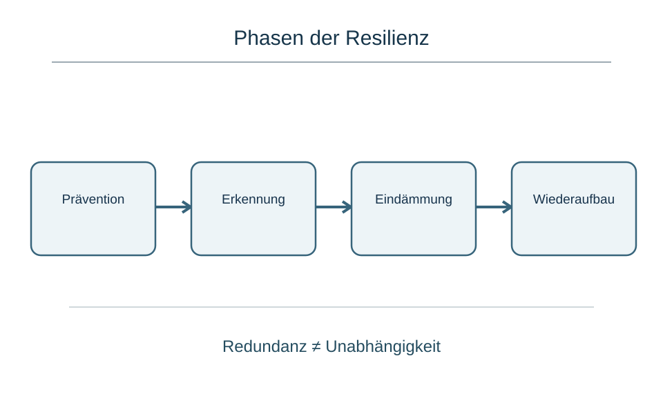

# M6-L3 – Versorgungssicherheit und Resilienz {#L3}

**Kursbereich:** M6 – Digitalisierung, Sicherheit und Resilienz  
**Niveau:** Bachelor · Aufbau/Wahlprofil  
**Vorwissen:** Grundlagen der elektrischen Größen und elementare Mathematik.  
**Lernziel:** Resilienzmaßnahmen und gemeinsame Ausfallursachen an einem Versorgungspfad bewerten.

## Einstieg {#S1}

Versorgungssicherheit fragt, ob Energie unter erwartbaren Bedingungen geliefert werden kann; Resilienz ergänzt die Fähigkeit, schwerwiegende Störungen zu bewältigen und sich davon zu erholen. Beide hängen von Technik, Organisation und kritischen Abhängigkeiten ab. Eine einzige redundante Leitung ist noch keine Garantie, wenn beide Leitungen denselben gefährdeten Korridor nutzen.

## Begriffe, Modell und Herleitung {#S2}

Ein strukturierter Resilienzzyklus besteht aus Vermeiden, Vorbereiten, Erkennen, Eindämmen, Wiederherstellen und Lernen. Zunächst werden kritische Funktionen statt nur einzelne Bauteile identifiziert: Wer braucht Strom, um wiederum Stromverteilung, Kühlung, Kommunikation oder Wasserpumpen zu betreiben? Danach werden Ausfallpfade, Ersatzversorgungen und Wiederanlaufbedingungen analysiert.

Redundanz erhöht nicht automatisch Unabhängigkeit. Zwei identische Systeme können durch dieselbe externe Ursache zugleich ausfallen (gemeinsame Ursache). Ein Inselbetriebsmodus braucht eine eigene sichere Frequenz-/Spannungsführung und Schutzkoordination; das bloße Abtrennen vom Verbundnetz genügt nicht. Netzwiederaufbau ist ein geregelter Prozess mit betrieblicher Priorisierung, keine improvisierte Umschaltung.

## Durchgerechnetes Beispiel {#S3}

Ein theoretisches Rechenzentrum erhält zwei Einspeisungen, die über unterschiedliche Transformatoren, aber denselben unterirdischen Kabelkanal verlaufen. Gegen Ausfall eines Transformators liegt Redundanz vor; gegen Beschädigung des gemeinsamen Kanals nicht. Ein resilienterer Entwurf würde unabhängige Trassen und die Abhängigkeit von Kommunikations- und Kühltechnik untersuchen. Eine pauschale Prozentzahl für den Sicherheitsgewinn ist ohne Ausfallraten nicht gerechtfertigt.

### Vertiefung 1

**Lernziel:** Wahrscheinlichkeit einer Unterdeckung und erwartete nicht gelieferte Energie aus diskreten Szenarien bestimmen.

Ressourcenadäquanz untersucht, ob verfügbare Erzeugung, Speicher, Importe und flexible Nachfrage den Bedarf unter angenommenen Szenarien decken können. Sie ist von Betriebsstabilität, lokaler Verteilnetzzuverlässigkeit und Wiederherstellungsfähigkeit nach Störungen zu unterscheiden. Die ENTSO-E verwendet unter anderem die erwartete Dauer von Unterdeckung (LOLE, Loss of Load Expectation) und die erwartete nicht gelieferte Energie (EENS, Expected Energy Not Served).

Für diskrete Szenarien $s$ mit Wahrscheinlichkeiten $p_s$ und Zeitschritten $t$ der Dauer $\Delta t$ sei $u_{s,t}=\max(0,D_{s,t}-A_{s,t})$ die nicht gedeckte Leistung. Dann gilt im Lehrmodell $\mathrm{LOLE}=\sum_s p_s\sum_t \mathbf{1}_{u_{s,t}>0}\Delta t$ und $\mathrm{EENS}=\sum_s p_s\sum_t u_{s,t}\Delta t$. $D$ und $A$ sind in MW, LOLE in Stunden und EENS in MWh für den betrachteten Zeitraum.

Betrachtet werden drei Stunden mit jeweils 100 MW Nachfrage. Die verfügbaren Leistungen sind:

| Szenario | Wahrscheinlichkeit | Stunde 1 | Stunde 2 | Stunde 3 | Unterdeckungsdauer | Fehlenergie |
|---|---:|---:|---:|---:|---:|---:|
| A | 0,70 | 110 | 105 | 105 | 0 h | 0 MWh |
| B | 0,20 | 90 | 95 | 105 | 2 h | 15 MWh |
| C | 0,10 | 100 | 80 | 90 | 2 h | 30 MWh |

LOLE = 0,6 h und EENS = 6 MWh je modelliertem Dreistundenzeitraum. Eine stets verfügbare zusätzliche 10-MW-Ressource reduziert in B die Unterdeckung vollständig und in C auf 10 MW in Stunde 2. Dann betragen LOLE 0,1 h und EENS 1 MWh. Das Modell setzt voraus, dass die Ressource die volle Leistung über alle Stunden liefern kann; bei einem Speicher wäre der Energieinhalt zusätzlich zu bilanzieren.

Die 0,6 h sind ein Erwartungswert über Szenarien, keine vorhergesagte Unterbrechungsdauer eines Haushalts. Die Dreistundenrechnung darf nicht ohne zeitliche Repräsentativität auf ein Jahr hochgerechnet werden. Reale Adäquanzstudien modellieren räumliche Netzverbindungen, Wetterkorrelationen, Ausfälle und zeitliche Flexibilitätsgrenzen.

## Selbstkontrolle {#S4}

### Aufgaben

1. Warum ist eine zweite Einspeiseleitung, die exakt dieselbe Brücke wie die erste nutzt, keine vollständige Risikominderung?
2. Zwei unabhängige Leitungen teilen eine einzige Stromversorgung für ihre Kommunikationsgeräte. Benenne einen gemeinsamen Ausfallmechanismus und eine zu prüfende Maßnahme.
3. Wie groß ist die Wahrscheinlichkeit mindestens einer Unterdeckungsstunde?
4. Wie groß sind LOLE und EENS bei zusätzlicher stets verfügbarer Leistung von 5 MW?
5. Warum genügt die Angabe eines 10-MW-Speichers nicht?

::: {.lc-solutions data-lc-section="S4"}
1. Ein einziges Ereignis wie die Sperrung oder Beschädigung der Brücke kann beide Leitungen gleichzeitig betreffen. Resilienz verlangt die Betrachtung gemeinsamer Ausfallursachen.
2. Ausfall gemeinsamer Hilfsenergie kann beide Kommunikationspfade betreffen; unabhängige Hilfsenergie und das Verhalten bei Kommunikationsverlust prüfen.
3. 0,3 vor zusätzlicher Ressource.
4. 0,4 h und 3 MWh.
5. Ohne Energieinhalt, Ladezustand, Wirkungsgrad und zeitliche Verfügbarkeit ist seine über mehrere Stunden lieferbare Leistung unbekannt.
:::

## Annahmen, Sicherheit und Grenzen {#S5}

Dies ist qualitative Risikoanalyse; es werden weder Zuverlässigkeitskennzahlen noch reale Sicherheitslücken eines bestimmten Netzes behauptet. Störungs- und Wiederaufbauverfahren müssen Betreiber fachlich und rechtlich absichern.

## Zusammenfassung und Übergang {#S6}

Resilienz umfasst Vorbereitung, Eingrenzung, Wiederherstellung und Lernen; eine zweite Leitung allein schafft nicht zwingend Unabhängigkeit. Die Planung vergleicht solche Risiken mit Netzgrenzen.

**Weiterlesen:** [M7-L1 – Netzplanung und N-1-Prinzip](M7-L1.md).

## Quellen (extern) {#S7}

- [Universität Stuttgart, Fakultät 5 – Electrical Power Systems](https://www.f05.uni-stuttgart.de/ei/studiengaenge/eeng/uebersicht/Electrical-Power-Systems/) · Studiengangsschwerpunkt Electrical Power Systems; Erzeugung, Verteilung, nachhaltige und zuverlässige Netze · Zuletzt abgerufen: 2026-11-23
- [TU Dresden, Fakultät Elektrotechnik und Informationstechnik – Wahlpflichtmodule ET, MT, IST, RES](https://tu-dresden.de/ing/elektrotechnik/studium/im_studium/lehrangebot/wahlpflichtmodule) · Planning of Electrical Power Systems / Fundamentals of Electrical Power Systems / Controlled Power Systems; Netzplanung, Netzberechnung, Betriebsmittel, Regelung · Zuletzt abgerufen: 2026-11-23
- [ENTSO-E – ERAA 2025](https://www.entsoe.eu/eraa/2025/) · Adequacy findings; probabilistische Versorgungssicherheit · Zuletzt abgerufen: 2026-11-24
