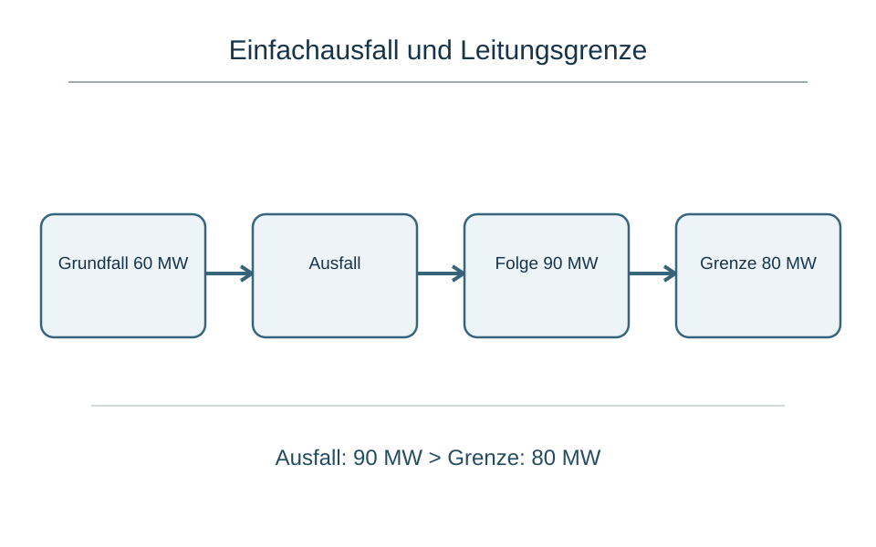

# M7-L1 – Netzplanung und N-1-Prinzip {#L1}

**Kursbereich:** M7 – Planung, Märkte und Systembewertung  
**Niveau:** Bachelor · Aufbau/Wahlprofil  
**Vorwissen:** Grundlagen der elektrischen Größen und elementare Mathematik.  
**Lernziel:** ein einfaches N-1-Szenario gegen eine vorgegebene Leitungsgrenze prüfen.

## Einstieg {#S1}

Ein Netzplan muss auch abweichende Betriebszustände berücksichtigen: höhere Last, andere Erzeugung oder den Ausfall einer Leitung. Das **N-1-Prinzip** untersucht, ob ein System nach dem Ausfall genau eines betrachteten Betriebsmittels die festgelegten betrieblichen Anforderungen noch einhalten kann. Welche Komponenten und Kriterien konkret gelten, wird nicht aus dem Begriff allein bestimmt.

## Begriffe, Modell und Herleitung {#S2}

Für eine endliche Menge plausibler Fälle $c$ werden Leistungsflüsse und Grenzen $|P_{\ell,c}|\le P_{\ell,\mathrm{max},c}$ geprüft, ebenso Spannungen und ggf. dynamische Kriterien. Die N-1-Prüfung ist keine Behauptung, dass jede denkbare Kombination mehrerer Ausfälle beherrscht wird. In der Planung können Redundanz, Netzausbau, Flexibilitäten oder betrieblich geplante Maßnahmen auf Engpässe reagieren.

Bei linearisierten Netzmodellen helfen Sensitivitäten, Fälle vorzusortieren. Die endgültige Bewertung verlangt passende AC-Rechnung und unter Umständen dynamische Untersuchungen. Netzplanung betrachtet auch Genehmigung, Umwelt, Kosten, Realisierungsdauer und Versorgungskritikalität; nicht nur die thermische Kante.

## Durchgerechnetes Beispiel {#S3}

Eine Leitung ist im Grundfall mit $60\,\mathrm{MW}$ belastet; im fiktiven Ausfall einer parallelen Leitung würde ihr Fluss auf $90\,\mathrm{MW}$ steigen. Die angenommene Grenze liegt bei $80\,\mathrm{MW}$. Das N-1-Szenario verletzt die Grenze um $10\,\mathrm{MW}$ oder 12,5 % bezogen auf 80 MW. Eine geeignete Planung muss etwa Netzverstärkung, bessere Lastverteilung oder zulässige betriebliche Gegenmaßnahmen prüfen.

### Vertiefung 1

Setze für jede Kante aus M4-L2 eine hypothetische Wirkleistungsgrenze von 70 MW in beiden Richtungen. Der Grundzustand (40/50/10 MW) hält diese Grenzen ein. Bei unveränderten Einspeisungen berechnen wir drei Einzelausfälle:

| Verfügbarkeit | A→B (MW) | A→C (MW) | B→C (MW) | Größte Grenzüberschreitung |
|---|---:|---:|---:|---:|
| Alle Zweige | 40 | 50 | 10 | 0 MW |
| A–B ausgefallen | – | 90 | −30 | 20 MW |
| A–C ausgefallen | 90 | – | 60 | 20 MW |
| B–C ausgefallen | 30 | 60 | – | 0 MW |

Ein negatives Vorzeichen bedeutet Fluss gegen die angegebene Richtung. Trotz intakter Verbindung jedes Knotens und ausgeglichener Bilanz versagen zwei Fälle an den Modellgrenzen. Als rein hypothetische präventive Maßnahme übernimmt eine steuerbare Erzeugung an C 20 MW der Einspeisung von A. Die neuen Nettoeinspeisungen sind A +70, B −30 und C −40 MW. Im Grundzustand ergeben sich 33⅓, 36⅔ und 3⅓ MW; bei Ausfall A–B beziehungsweise A–C trägt der jeweils verbleibende von A ausgehende Zweig 70 MW. Bei Ausfall B–C sind es 30 und 40 MW. Alle drei betrachteten Modellfälle erfüllen die Wirkleistungsgrenze. Das ist kein praktischer N-1-Freigabenachweis: reale Grenzen hängen unter anderem von Scheinleistung, Spannung, Dynamik, Schaltzustand, verfügbarer Erzeugung und den anwendbaren Regeln ab.

## Selbstkontrolle {#S4}

### Aufgaben

1. Reicht es als N-1-Nachweis aus, nur die Summenerzeugung und Summenlast nach dem Leitungsausfall zu vergleichen?
2. Ein fiktiver Zweig ist nach einem Einzelausfall mit 84 MW belastet; die angenommene Grenze beträgt 70 MW. Bestimme die absolute und relative Überschreitung.
3. Warum genügt die Gesamtbilanz nicht für die Ausfallprüfung?
4. Warum müssen im beschriebenen präventiven Modell mindestens 20 MW von A an C verlagert werden?

::: {.lc-solutions data-lc-section="S4"}
1. Nein. Selbst bei ausgeglichener Gesamtleistung können einzelne verbleibende Leitungen überlastet sein oder Spannungsgrenzen verletzt werden. Der Zustand muss netzbezogen berechnet werden.
2. 14 MW; 20 % bezogen auf die Grenze.
3. Die Summe bleibt null, aber die verbleibenden Zweige können ihre Grenzen überschreiten.
4. Nach Verlust einer der beiden von A ausgehenden Leitungen muss die andere die gesamte Einspeisung von A tragen. Also gilt $90-g_C\le70$ MW, mithin $g_C\ge20$ MW. Die übrigen Zweiggrenzen wurden zusätzlich geprüft.
:::

## Annahmen, Sicherheit und Grenzen {#S5}

Das Modul belegt keine verbindlichen N-1-Ausnahmen, Ausfalllisten oder Grenzwertregeln für einen bestimmten Staat oder Netzbetreiber. Für reale Netzplanung werden offiziell gültige Kriterien benötigt.

## Zusammenfassung und Übergang {#S6}

N-1 bewertet einzelne angenommene Ausfälle und verbleibende Netzgrenzen, nicht jede denkbare Mehrfachstörung. Netzplanung berücksichtigt zudem Markt- und Einsatzbedingungen.

**Weiterlesen:** [M7-L2 – Energiewirtschaft und Netzengpassmanagement](M7-L2.md).

## Quellen (extern) {#S7}

- [TU Dresden, Fakultät Elektrotechnik und Informationstechnik – Wahlpflichtmodule ET, MT, IST, RES](https://tu-dresden.de/ing/elektrotechnik/studium/im_studium/lehrangebot/wahlpflichtmodule) · Planning of Electrical Power Systems / Fundamentals of Electrical Power Systems / Controlled Power Systems; Netzplanung, Netzberechnung, Betriebsmittel, Regelung · Zuletzt abgerufen: 2026-11-23
- [KIT, Institut für Elektroenergiesysteme und Hochspannungstechnik – Elektrische Energienetze](https://www.ieh.kit.edu/2448_bee.php) · Inhaltsverzeichnis EEN (WS), Abschnitte 1–5; Drehstrom, Leistungsfluss, Netze, Fehler · Zuletzt abgerufen: 2026-11-23
- [Universität Stuttgart – Prüfungsordnung Nr. 36/2025](https://www.uni-stuttgart.de/universitaet/aktuelles/bekanntmachungen/Amtliche-Bekanntmachung-Nummer-36-2025/) · Anlage 2, § 5 Abs. 2 a), Stromnetz-/Erneuerbaren-Module im gewählten Bachelor-Wahlbereich · Webansicht geprüft: 2026-11-23
- [MATPOWER – DC Power Flow](https://matpower.app/manual/matpower/DCPowerFlow.html) · § 4.2; reduzierte Knotenmatrix und Zweigflüsse · Zuletzt abgerufen: 2026-11-24
