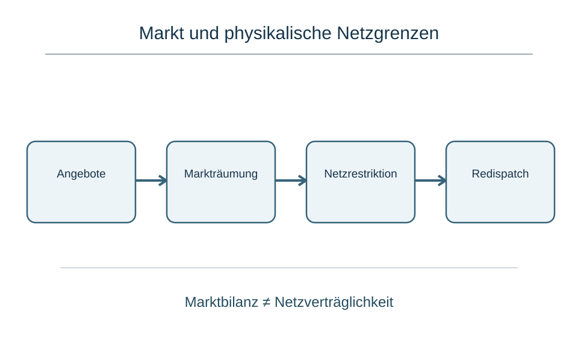

# M7-L2 – Energiewirtschaft und Netzengpassmanagement {#L2}

**Kursbereich:** M7 – Planung, Märkte und Systembewertung  
**Niveau:** Bachelor · Aufbau/Wahlprofil  
**Vorwissen:** Grundlagen der elektrischen Größen und elementare Mathematik.  
**Lernziel:** Gebotswerte, Grenzpreis, Modellzahlungen und tatsächliche Erzeugungskosten unterscheiden.

## Einstieg {#S1}

Ein Strommarkt koordiniert wirtschaftliche Angebote und Nachfrage; das physikalische Stromnetz bestimmt zugleich, ob die daraus entstehenden Einspeise- und Entnahmemuster transportierbar sind. Markträumung ohne Netzrestriktion und Netzengpassmanagement sind daher zwei analytisch unterschiedliche Probleme.

## Begriffe, Modell und Herleitung {#S2}

In einem vereinfachten stündlichen Merit-Order-Modell werden Erzeugungsgebote nach ihrem **Gebotspreis** gereiht und bis zur Deckung der angenommenen Nachfrage angenommen. Ein Gebotspreis kann die kurzfristigen Grenzkosten widerspiegeln, **muss aber nicht mit den tatsächlich entstandenen Erzeugungskosten übereinstimmen**. Für diskrete Blöcke ist $C_\mathrm{Gebot}=\sum_i p_iE_i$ die **Summe der Gebotswerte** der angenommenen Energiemengen $E_i$ mit den jeweiligen Gebotspreisen $p_i$; sie ist weder automatisch eine Kostenrechnung der Anlagen noch der an der Börse tatsächlich gezahlte Betrag.

Unter der ausdrücklich zusätzlichen Annahme eines einheitlichen Grenzpreises $p_\mathrm{marg}$ kann der rein rechnerische Erlös der angenommenen Anbieter $R_\mathrm{Modell}=p_\mathrm{marg}\sum_iE_i$ betragen. Grenzpreis, Gebotsmittelwert, tatsächliche Grenzkosten und reale Zahlungsströme sind **vier verschiedene Größen**; detaillierte Marktregeln, weitere Gebühren und Verträge bleiben ausgeklammert.

Ein Markt kann ein Einspeiseprofil ergeben, das ein Leitungsmodell überlastet. Dann sind physikalische Gegenmaßnahmen und gegebenenfalls Redispatch nötig. Netzbetreiber, Marktrollen, Entgelte und Vergütung sind durch zeit- und landesspezifische Regeln definiert; dieses Kapitel beschreibt keine aktuell gültige Marktordnung.

## Durchgerechnetes Beispiel {#S3}

Ein **rein fiktiver** Markt benötigt eine Stunde lang konstant $60\,\mathrm{MW}$. Anbieter A bietet $40\,\mathrm{MW}$ zu $30\,\mathrm{EUR/MWh}$ und B weitere $20\,\mathrm{MW}$ zu $70\,\mathrm{EUR/MWh}$ an. In einer Stunde werden 40 bzw. 20 MWh zugeteilt. Die **Summe der angenommenen Gebotswerte** ist $C_\mathrm{Gebot}=40\cdot30+20\cdot70=2600\,\mathrm{EUR}$; ihr gewichteter Mittelwert ist $2600/60\approx43{,}33\,\mathrm{EUR/MWh}$. Der letzte angenommene Gebotspreis beträgt $70\,\mathrm{EUR/MWh}$. **Nur unter der zusätzlichen Modellannahme** einer einheitlichen Vergütung aller $60\,\mathrm{MWh}$ zu diesem Preis wären $R_\mathrm{Modell}=60\cdot70=4200\,\mathrm{EUR}$ zu zahlen; die Differenz $1600\,\mathrm{EUR}$ ist **kein** nachgewiesener Unternehmensgewinn. Weder die tatsächlichen Erzeugungskosten noch reale Börsenabrechnungen sind angegeben.

## Selbstkontrolle {#S4}

### Aufgaben

1. Warum ist es fachlich falsch, aus dem Grenzpreis von 70 €/MWh zu folgern, jede erzeugte MWh habe den Anbieter 70 € gekostet?
2. In einem fiktiven einstündigen Einheitspreismodell werden 20 MW zu 40 EUR/MWh und 10 MW zu 70 EUR/MWh angenommen. Bestimme Gebotssumme und Modellzahlung.

::: {.lc-solutions data-lc-section="S4"}
1. Der Grenzpreis ist hier der Preis des letzten angenommenen Gebots im vereinfachten Marktmodell. Der gebotsgewichtete Mittelwert beträgt 43,33 €/MWh und darf **nicht** als belegter durchschnittlicher Anlagenkostensatz bezeichnet werden; reale Kosten, Erlöse und individuelle Verträge sind gesondert zu ermitteln.
2. 800+700=1500 EUR; 30×70=2100 EUR. Differenz ist kein nachgewiesener Gewinn.
:::

## Annahmen, Sicherheit und Grenzen {#S5}

Die Rechnung ignoriert Netzrestriktionen, An-/Abfahrkosten, Speicher, Steuern, Abgaben und reale Marktdesigns. Ein angenommener Einheitspreis ist hier **nur eine Lernmodellannahme**, keine Aussage zu einer aktuell anwendbaren Abrechnungsregel. Börsenpreise und Rechtsregeln ändern sich; das Beispiel darf nicht als Marktprognose genutzt werden.

## Zusammenfassung und Übergang {#S6}

Markträumung und physikalische Netzverträglichkeit sind unterschiedliche Bedingungen. Ein systemweiter Projektvergleich muss weitere Wirkungen und Systemgrenzen einbeziehen.

**Weiterlesen:** [M7-L3 – Systemvergleich und integrierte Fallstudie](M7-L3.md).

## Quellen (extern) {#S7}

- [Bundesnetzagentur – Redispatch](https://www.bundesnetzagentur.de/DE/Fachthemen/ElektrizitaetundGas/Versorgungssicherheit/Netzengpassmanagement/Engpassmanagement/Redispatch/artikel.html) · Einleitung und Redispatch-Abschnitte; Netzengpass, Eingriff in Erzeugungsleistung, Blindleistung · Zuletzt abgerufen: 2026-11-23
- [Universität Stuttgart, Fakultät 5 – Electrical Power Systems](https://www.f05.uni-stuttgart.de/ei/studiengaenge/eeng/uebersicht/Electrical-Power-Systems/) · Studiengangsschwerpunkt Electrical Power Systems; Erzeugung, Verteilung, nachhaltige und zuverlässige Netze · Zuletzt abgerufen: 2026-11-23
- [Bundesnetzagentur/SMARD – So funktioniert der Strommarkt](https://www.smard.de/page/home/wiki-article/446/384) · Abschnitt „Günstige Erzeugung hat Vorrang“; Merit-Order-Gebote, typische Grenzkosten und Grenzpreismodell; keine allgemeingültige Abrechnungszusage · Webansicht geprüft: 2026-11-23
