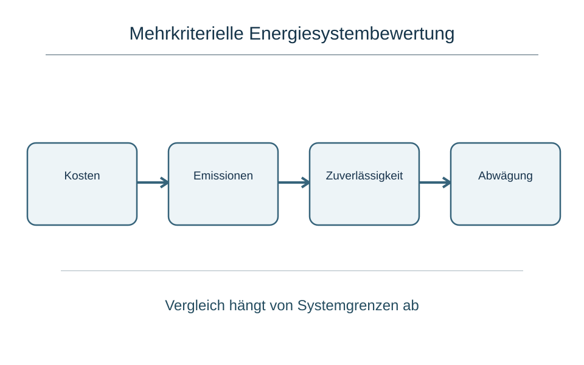

# M7-L3 – Systemvergleich und integrierte Fallstudie {#L3}

**Kursbereich:** M7 – Planung, Märkte und Systembewertung  
**Niveau:** Bachelor · Aufbau/Wahlprofil  
**Vorwissen:** Grundlagen der elektrischen Größen und elementare Mathematik.  
**Lernziel:** vereinfachte Stromgestehungskosten berechnen und Mehrkriterienbewertungen kritisch einordnen.

## Einstieg {#S1}

Ein Energiesystem hat mehrere Zielgrößen, die einander widersprechen können: niedrige Kosten, geringe Umweltbelastung, sichere Versorgung, technologische Flexibilität und gesellschaftliche Akzeptanz. Ein sauberer Vergleich macht **Systemgrenze, Zeitraum, Szenario, Datenstand und Unsicherheiten** sichtbar, statt eine vermeintlich objektive Einzahl zu erzeugen.

## Begriffe, Modell und Herleitung {#S2}

Für einen stark vereinfachten Kostenvergleich kann man $LCOE=C_\mathrm{annuell}/E_\mathrm{annuell}$ verwenden, wenn Kosten bereits korrekt annuitisiert und der Energieertrag über denselben Zeitraum erfasst ist. Reale Vollkostenmodelle berücksichtigen Kapitaldienst, Betrieb, Brennstoffe, Restwerte und Systemeffekte. Für CO₂-Bilanzen sind Lebenszyklusgrenze und Herkunft der Emissionsfaktoren wichtig. Verfügbarkeit und Versorgungssicherheit können nicht allein durch €/MWh oder Emissionen erfasst werden.

Eine Mehrkriterienmatrix bewertet Alternativen getrennt nach Kosten, Emissionen, Systembeitrag und Risiken. Gewichtungen sind offen zu legen, denn unterschiedliche Gewichtungen können die Rangfolge verändern. Ein **Stresstest** mit abweichender Wind- oder Lastzeitreihe ist aussagekräftiger als ein einziges Schönwetterszenario.

Die Quotientenrechnung ist nur dann als vereinfachter LCOE-Vergleich interpretierbar, wenn die Jahreskosten **bereits auf dieselbe wirtschaftliche Betrachtungsweise annuitisiert** sind und Erträge sowie Kosten dieselbe Systemgrenze abdecken. Ein vollständiges Projekt-LCOE erfordert sonst eine konsistente Betrachtung diskontierter Lebenszeitkosten und Energieerträge. Ein Netzwertbeitrag ergibt sich aus dem €/MWh-Ergebnis allein nicht.

## Durchgerechnetes Beispiel {#S3}

Zwei **rein fiktive** Projekte werden bei vergleichbarer Systemgrenze betrachtet. Projekt A kostet jährlich $3{,}0$ Mio. € und liefert $60\,\mathrm{GWh}$; $LCOE_A=(3{,}0\cdot10^6\,\mathrm{EUR})/(60\cdot10^3\,\mathrm{MWh})=50\,\mathrm{EUR/MWh}$. Projekt B kostet jährlich $4{,}2$ Mio. € und liefert $70\,\mathrm{GWh}$; $LCOE_B=60\,\mathrm{EUR/MWh}$. A ist nach dieser Kennzahl günstiger, doch ohne Verfügbarkeits-, Netz- und Umweltdaten ist keine umfassende Investitionsentscheidung möglich.

### Vertiefung 1

Vier Intervalle von je einer Stunde: Last [4, 6, 7, 5] MW, Wind [6, 4, 2, 5] MW. Ein Speicher besitzt 4 MWh nutzbare Kapazität, Startenergie 1 MWh, Lade- und Entladegrenze 2 MW und je 90 % Wirkungsgrad. Eine steuerbare Reserve deckt verbleibende Defizite; kein Export. Die Speicherregel nutzt Überschuss zum Laden und entlädt bei Defiziten nur bis zum erlaubten Energieinhalt. Vernachlässigt werden Netzverluste und Selbstentladung.

| Stunde | Last | Wind | Laden MW | Entladen MW | Speicherende MWh | Reserve MW | Abregelung MW |
|---|---:|---:|---:|---:|---:|---:|---:|---:|
| 1 | 4 | 6 | 2 | 0 | 2,8 | 0 | 0 |
| 2 | 6 | 4 | 0 | 2 | 0,57778 | 0 | 0 |
| 3 | 7 | 2 | 0 | 0,52 | 0 | 4,48 | 0 |
| 4 | 5 | 5 | 0 | 0 | 0 | 0 | 0 |

Die Reserve liefert 4,48 MWh; ohne Speicher wären 7 MWh Reserve und 2 MWh Abregelung notwendig. Der Vergleich verwendet unterschiedliche Endenergie gegenüber Startenergie und ist daher kein zyklischer Tagesvergleich. Für eine faire Optimierung über wiederholte Zyklen muss ein End-SOC-Kriterium eingeführt werden; eine kostenoptimale Fahrweise lässt sich aus der heuristischen Regel nicht ableiten.

### Vertiefung 2

Wir übernehmen die hypothetischen Last-/Winddaten der v1.0.12 Fallstudie: je eine Stunde, Last 4/6/7/5 MW und Wind 6/4/2/5 MW, Kapazität 4 MWh, Anfangsenergie 1 MWh, beide Leistungsgrenzen 2 MW, beide Wirkungsgrade 0,9. Zusätzlich fordern wir $E_4=E_0=1$ MWh, kein Export, kein Laden aus Reserve und keine gleichzeitige Ladung/Entladung. Reserve ist nicht leistungsbeschränkt; wir minimieren ausschließlich die Summe der Reserveenergie ohne Kosten- oder Emissionsunterschiede zwischen Stunden.

Der Überschuss in Stunde 1 beträgt 2 MWh. Er erhöht den Energieinhalt um 1,8 MWh; bei gleichem End- und Anfangsinhalt dürfen daher insgesamt nur $1{,}8\cdot0{,}9=1{,}62$ MWh elektrisch abgegeben werden. Eine zulässige Lösung:

| Stunde | Laden (MW) | Entladen (MW) | Energie am Ende (MWh) | Reserve (MW) | Abregelung (MW) |
|---|---:|---:|---:|---:|---:|
| 1 | 2 | 0 | 2,8 | 0 | 0 |
| 2 | 0 | 1,62 | 1 | 0,38 | 0 |
| 3 | 0 | 0 | 1 | 5 | 0 |
| 4 | 0 | 0 | 1 | 0 | 0 |

Die Gesamtreserve beträgt 5,38 MWh, gegenüber 7 MWh ohne Speicher. Die Verringerung von 1,62 MWh ist genau die nutzbare Energie des eingefangenen Überschusses; 0,38 MWh entfallen auf Umwandlungsverluste. Unter diesen speziellen Annahmen ist das Minimum der Reserveenergie 5,38 MWh: mehr als 2 MWh Ladeenergie stehen nicht zur Verfügung, und 81 % davon sind als zyklische elektrische Abgabe nutzbar. Die zeitliche Aufteilung ist nicht eindeutig. Ein anderer Fahrplan könnte dieselbe Entladung in Stunde 3 durchführen und damit die Reservespitze senken. Die nichtzyklische Variante in v1.0.12 benötigt 4,48 MWh Reserve, verbraucht aber zusätzlich den anfänglichen Energieinhalt von 1 MWh (0,9 MWh elektrische Abgabe). Beide Fälle dürfen nicht als gleichwertige, wiederholbare Zyklen verglichen werden.

## Selbstkontrolle {#S4}

### Aufgaben

1. Warum kann das Projekt mit niedrigeren reinen Stromgestehungskosten für ein Inselnetz dennoch die schlechtere Option sein?
2. Zwei hypothetische Projekte liefern 40 GWh pro Jahr; die äquivalenten jährlichen Kosten sind 2,4 und 3,2 Mio. EUR. Vergleiche LCOE und nenne eine fehlende Vergleichsgröße.
3. In welchem Intervall beschränkt die Energie und nicht die Nennleistung des Speichers die Entladung?
4. Wie verändert sich die maximale Entladeleistung im dritten Intervall, wenn 0,2 MWh als Mindestenergie zurückgehalten werden?
5. Wie hoch ist die maximale Reserveleistung im angegebenen Fahrplan? Wie lässt sie sich bei gleicher Reserveenergie durch Verschieben der Entladung auf Stunde 3 senken?
6. Bei welchen zusätzlichen Annahmen wäre eine Minimierung der Reserveenergie nicht ausreichend, um den wirtschaftlich besten Fahrplan zu bestimmen?

::: {.lc-solutions data-lc-section="S4"}
1. Wenn Leistung genau dann ausfällt, wenn sie gebraucht wird, können zusätzliche Speicher-, Reserve- oder Netzkosten entstehen. Kosten je MWh ohne zeitlichen Systemwert und Zuverlässigkeit sind unvollständig.
2. 60 und 80 EUR/MWh; z. B. zeitliche Verfügbarkeit oder zusätzliche Reservekosten.
3. Stunde 3: nur 0,52 MW sind eine Stunde lang aus der Restenergie lieferbar.
4. $(0{,}57778-0{,}2)\cdot0{,}9\approx0{,}34$ MW. Die Reserve muss 4,66 MW liefern.
5. Zunächst 5 MW. Entlädt man die gesamten 1,62 MW erst in Stunde 3, beträgt die Reserve dort 3,38 MW und in Stunde 2 2 MW; die Spitze sinkt auf 3,38 MW. Die Summe bleibt 5,38 MWh. Da die Stunde 3 allein 5 MW Defizit hat und höchstens 1,62 MWh zyklisch entladen werden können, ist dies auch die kleinste erreichbare Reservespitze im Beispiel.
6. Beispielsweise stündlich variable Reservekosten, Start- und Rampenkosten, Speicherdegradation, Netzengpässe oder unterschiedliche Emissionen.
:::

## Annahmen, Sicherheit und Grenzen {#S5}

Alle Werte sind hypothetisch. Es fehlen reale Anlagenbudgets, einheitliche Lebenszyklusdaten, Umweltwirkungen und Quellenunsicherheiten. Der Kurs erstellt keine politische Empfehlung und ersetzt keine offizielle Planungsstudie.

## Zusammenfassung und Übergang {#S6}

Ein €/MWh-Vergleich ist nur innerhalb klar gleicher Kosten- und Energiegrenzen sinnvoll. Zuverlässigkeit, Emissionen und Netzintegration erfordern zusätzliche transparent gewichtete Kriterien.

## Quellen (extern) {#S7}

- [Universität Stuttgart, Fakultät 5 – Electrical Power Systems](https://www.f05.uni-stuttgart.de/ei/studiengaenge/eeng/uebersicht/Electrical-Power-Systems/) · Studiengangsschwerpunkt Electrical Power Systems; Erzeugung, Verteilung, nachhaltige und zuverlässige Netze · Zuletzt abgerufen: 2026-11-23
- [TU Dresden, Fakultät Elektrotechnik und Informationstechnik – Wahlpflichtmodule ET, MT, IST, RES](https://tu-dresden.de/ing/elektrotechnik/studium/im_studium/lehrangebot/wahlpflichtmodule) · Planning of Electrical Power Systems / Fundamentals of Electrical Power Systems / Controlled Power Systems; Netzplanung, Netzberechnung, Betriebsmittel, Regelung · Zuletzt abgerufen: 2026-11-23
- [PyPSA – Storage](https://docs.pypsa.org/latest/user-guide/optimization/storage/) · Storage Units; zeitgekoppelte Speicherbilanz und zyklische Randbedingung · Zuletzt abgerufen: 2026-11-24
